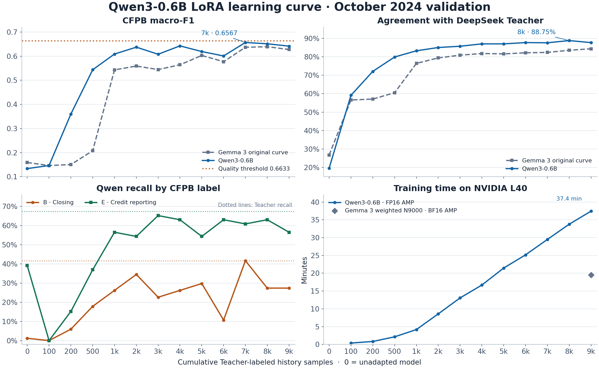
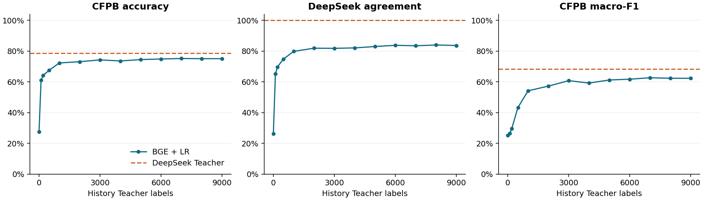
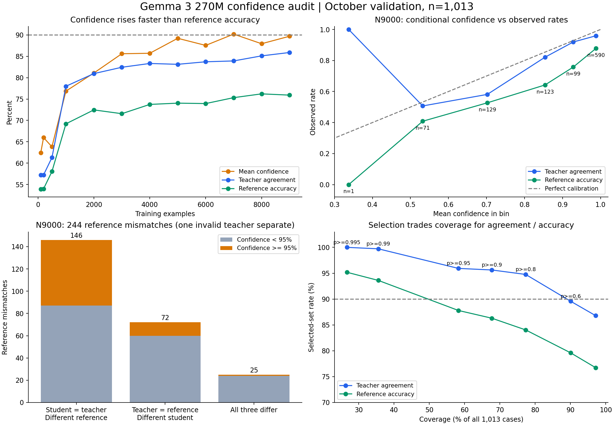
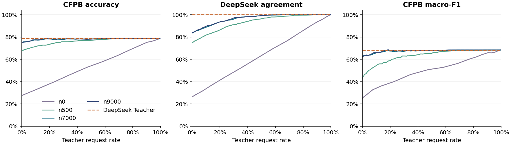

# LLM-JIT 第一阶段分类与蒸馏实验结果

第一阶段评估用历史请求积累的 DeepSeek 标签训练轻量 Student，能在后续请求上保留多少分类质量与 Teacher 一致性。DeepSeek 完成了 **12,196 条** 2024 年 CFPB 房贷投诉的全量推理。Gemma 3 LoRA、Qwen3 LoRA 和 BGE + LR 均在同一批 **1,013 条** October validation 上完成了从未训练基线到 9,000 个训练标签的评估。

纯 Student 中，**Qwen3 n8000 的准确率和 Teacher 一致率最高，分别为 77.10% 和 88.75%**，**Qwen3 n7000 的 Macro-F1 最高，为 0.6567**。DeepSeek 在同批请求上的准确率为 **78.58%**，Macro-F1 为 **0.6833**。所有纯 Student 节点均低于预设的 **0.6633 Macro-F1** 门槛。离线门控中，BGE + LR n9000 在 **18.56%** 的请求上回退给 Teacher，混合准确率为 **78.58%**，Macro-F1 为 **0.6856**。该阈值来自验证集搜索。[实验设计](../Experiment%20Design.md) · [Teacher 全量报告](teacher_deepseek-v4.1-flash-1017_all/note.md) · [Qwen3 学习曲线](validation/qwen3-0.6b-v3-lora-curve/note.md) · [BGE + LR 实验](validation/bge-small-en-v1.5-v3-embedding-lr/note.md)

## 数据、训练启动点与评分口径

任务输入是公开投诉正文，输出为 A–E 中的一个类别。A 为申请或再融资，B 为签约或交割，C 为贷后账户管理，D 为还款困难或救济，E 为征信及相关服务。CFPB 参考标签来自消费者填表时选择的 `Issue`。v3 提示词要求根据正文识别消费者最希望解决的问题，并提供五个固定示例。正文规范化、去重后，投诉按 UTC 收件时间排列。[数据与误差分析](../Dataset_Error_Analysis.md) · [v3 提示词](../code/prompts/mortgage_v3.toml)

| 分区 | 2024 年收件时间 | 数量 | 第一阶段用途 |
|---|---|---:|---|
| History | 1–9 月 | 9,159 | 收集监督标签，取得 9,155 条合法 Teacher 标签 |
| Validation | 10 月 | 1,013 | 比较三类 Student、超参和门控策略 |
| Test | 11–12 月 | 2,024 | DeepSeek 已评分，Student 最终留出集评估待完成 |

各训练前缀取最早到达的前 `n` 条合法 Teacher 标签，节点为 **100、200、500，以及 1,000 到 9,000 的每个千条节点**。每个前缀包含此前的较小前缀，以第 `n` 条合法记录的收件时间模拟训练启动时点。n100、n2000、n8000、n9000 分别对应 **1 月 4 日、2 月 28 日、8 月 28 日和 9 月 25 日 UTC**。每个 LoRA 节点从对应模型的原始基座独立训练适配器，再对完整 10 月分区推理。这个离线设计度量不同等待时长对应的训练效果，实际上线就绪时间还需计入训练、验证和加载。[训练前缀清单](../data/lora/teacher_deepseek-v4.1-flash-1017_v3/manifest.json) · [流式回放设计](../Experiment%20Design.md)

- **Accuracy 和 Macro-F1** 以 CFPB 参考标签为准。Macro-F1 对五类等权。验证集中 C 有 562 条，占 55.48%，固定预测 history 多数类 C 的 Accuracy 为 55.48%，Macro-F1 为 0.1427。[多数类与分区对照](teacher_deepseek-v4.1-flash-1017_all/note.md)
- **Teacher 一致率** 衡量 Student 与 DeepSeek 给出同一个合法标签的比例，分母为全部 1,013 条。Gemma 3 和 Qwen3 的主结果使用严格自由生成，最终无效输出计错。首 token A–E 五选一作为单独标注的诊断口径。[指标与输出口径](validation/gemma3-270m-it-v3-cgtf/note.md)

## 推理基线与 Teacher 结果

### 300 条开发预实验

从 2024 年 1 月按类别分层抽取 300 条，使用 seed 42。Gemma 4 31B IT 和 SmolLM2-135M 对照了 v1–v4 提示词。Gemma 4 在 v3 的 Accuracy 和 Macro-F1 均为最高，分别为 **80.00%** 和 **0.6788**。在同一 v3 开发集上，未经微调的 Gemma 3 270M IT、Qwen3.5-0.8B 和 SmolLM2 分别取得 **29.00%、30.33%、16.00%** 的 Accuracy，与当时 Gemma 4 Teacher 的一致率分别为 **31.00%、31.00%、13.33%**。SmolLM2 在 v4 的合法输出率达到 100%，Accuracy 降至 **10.00%**，说明格式有效性与分类质量需要分别跟踪。1 月样本现在属于 history，正式对比使用 10 月分区与 DeepSeek Teacher。另一次 Gemma 4 全年扩展收集归档了 **591/12,196** 条终态结果。[提示词 v1–v4 对照](pre-run%20300%20sample%20test/gemma/v4/note.md) · [开发集模型对照](pre-run%20300%20sample%20test/gemma3-270m-it-v3/note.md) · [Gemma 4 扩展运行记录](../output/baseline_v3/teacher_all/metrics.json)

### DeepSeek 全年推理

正式 Teacher 为 `deepseek-ai/DeepSeek-V4.1-Flash-1017`，通过 SiliconFlow 使用冻结的 v3 提示词调用，temperature 为 0，最多输出 16 token，关闭 thinking。Teacher 和生成式 Student 共用正文截短规则，超过 3,000 个共享 tokenizer token 时保留头部 2,000 和尾部 1,000。DeepSeek 共给出 **12,189 条合法输出**，另有 **7 条最终无效**，共 **12,205 次 API 尝试**，其中 9 次为重试。[Teacher 运行设置和逐条结果](teacher_deepseek-v4.1-flash-1017_all/note.md)

| 分区 | 答对 / 总数 | Accuracy | Macro-F1 | 有效率 |
|---|---:|---:|---:|---:|
| History | 7,213 / 9,159 | 78.75% | 0.6556 | 99.96% |
| Validation | 796 / 1,013 | 78.58% | 0.6833 | 99.90% |
| Test | 1,608 / 2,024 | 79.45% | 0.6595 | 99.90% |
| 全年 | 9,617 / 12,196 | 78.85% | 0.6591 | 99.94% |

Teacher 在 10 月的 B 类召回率为 **41.67%**，C 与 D 双向混淆 **80 条**，占 217 条错例的 **36.87%**。11–12 月的 Accuracy 更高，期间多数类 C 的比重也更高，B 类召回降至 **26.17%**。用固定的 history 类别占比重新加权后，10 月与 11–12 月的 Teacher Accuracy 分别为 **79.13%** 和 **79.22%**。[分区与类别构成分析](teacher_deepseek-v4.1-flash-1017_all/note.md)

### 未微调 Student 的完整验证推理

Gemma 3 270M IT 使用 v3 few-shot 在 CUDA 上评估完整 10 月数据，取得 **26.75% Accuracy、0.1591 Macro-F1、26.75% Teacher 一致率**。166 条请求重试后仍为空，复跑逐条复现了相同输出及相同的失败样本。后续可配对归档覆盖全部 1,013 条。Qwen3-0.6B 使用 v3 并关闭 thinking，取得 **18.46% Accuracy、0.1337 Macro-F1、19.64% Teacher 一致率**，合法输出率为 100%。BGE + LR 的 n0 从 v3 的五段类别描述构造零样本分类头，取得 **27.44% Accuracy、0.2514 Macro-F1、26.36% Teacher 一致率**。[Gemma 3 基线与复跑](validation/gemma3-270m-it-v3-cuda/note.md) · [Gemma 3 完整配对指标](../output/baseline_v3/student_gemma3-270m-it_validation_cuda_run3/metrics.json) · [Qwen3 基线](../output/baseline_v3/student_qwen3-0.6b_validation_cuda/metrics.json) · [BGE n0 参数与结果](validation/bge-small-en-v1.5-v3-embedding-lr/note.md)

## Student 训练和验证推理

归档包含 **36 组 LoRA 训练及其 10 月验证推理**。Gemma 3 原学习曲线 12 组、固定 n9000 的超参扫描 10 组、B/E 加权 1 组。Qwen3 FP16 学习曲线 12 组，另有独立 n9000 运行 1 组。BGE 另保存 12 个拟合的 LR 分类头和 1 个 n0 原型分类头。[Gemma 曲线](validation/gemma3-270m-it-v3-lora-curve/note.md) · [Gemma 超参扫描](validation/gemma3-270m-it-v3-n9000-lora-sweep/note.md) · [Qwen 曲线及加权对照](validation/qwen3-0.6b-v3-lora-curve/note.md) · [Qwen 独立训练记录](../output/lora/qwen3-0.6b_v3_n9000_fp16_mixed/training.json) · [BGE 参数](validation/bge-small-en-v1.5-v3-embedding-lr/models/)

| 方案 | 训练设置 | 验证推理 |
|---|---|---|
| Gemma 3 270M IT LoRA | Quadro RTX 6000、FP32、`q_proj` / `v_proj`、rank 8、alpha 16、dropout 0.05、学习率 `2e-4`、3 个 epoch、有效 batch 8、micro-batch 1、seed 42。监督目标为 Teacher 字母及回合终止符 | CUDA FP32、v3、贪心自由生成，严格解析 A–E |
| Qwen3-0.6B LoRA | NVIDIA L40、FP16 AMP、FP32 LoRA 参数与优化器状态，有效 batch 8、micro-batch 2。学习率、rank、alpha、epoch 和 seed 与原 Gemma 3 曲线一致。监督目标为 Teacher 字母及回合终止符 | CUDA FP32、v3、关闭 thinking。全部 12 个 LoRA 节点和 n0 的首轮输出均有效 |
| BGE Small + LR | 在 Quadro RTX 6000 上以 FP16 用冻结的 `BAAI/bge-small-en-v1.5` 编码。正文按最多 510 个内容 token 分块，归一化 CLS 按块长加权后再归一化得到 384 维向量。CPU 拟合 L2 多项 LR，固定 `C=10` 和 L-BFGS | 输出五类 softmax 概率并记录最大值。n0 权重为 10 倍类别描述单位向量，偏置为 0 |

### 逐节点结果

每格依次为 **Accuracy / Macro-F1 / Teacher 一致率**。粗体标出各模型在标准学习曲线中的单项最高值，Gemma 3 的额外优化配置见下一节。[Gemma 全表](validation/gemma3-270m-it-v3-lora-curve/note.md) · [Qwen 全表](validation/qwen3-0.6b-v3-lora-curve/note.md) · [BGE 验证 CSV](validation/bge-small-en-v1.5-v3-embedding-lr/validation_metrics.csv)

| 训练标签数 | Gemma 3 LoRA | Qwen3 LoRA | BGE + LR |
|---:|---:|---:|---:|
| 0 | 26.75% / 0.1591 / 26.75% | 18.46% / 0.1337 / 19.64% | 27.44% / 0.2514 / 26.36% |
| 100 | 53.31% / 0.1463 / 56.56% | 55.58% / 0.1464 / 59.13% | 61.01% / 0.2642 / 65.15% |
| 200 | 53.80% / 0.1504 / 57.06% | 63.67% / 0.3599 / 72.06% | 64.17% / 0.2964 / 69.69% |
| 500 | 57.35% / 0.2078 / 60.51% | 70.38% / 0.5436 / 79.86% | 67.52% / 0.4324 / 74.83% |
| 1,000 | 67.82% / 0.5430 / 76.41% | 72.46% / 0.6088 / 83.22% | 72.26% / 0.5415 / 79.76% |
| 2,000 | 71.08% / 0.5589 / 79.37% | 74.83% / 0.6372 / 85.00% | 73.05% / 0.5719 / 81.84% |
| 3,000 | 70.19% / 0.5443 / 80.85% | 73.64% / 0.6078 / 85.69% | 74.23% / 0.6073 / 81.74% |
| 4,000 | 72.36% / 0.5642 / 81.74% | 76.60% / 0.6425 / 86.97% | 73.54% / 0.5918 / 82.03% |
| 5,000 | 72.66% / 0.6029 / 81.54% | 74.93% / 0.6190 / 86.97% | 74.43% / 0.6118 / 82.92% |
| 6,000 | 72.56% / 0.5770 / 82.13% | 75.32% / 0.6007 / 87.66% | 74.83% / 0.6169 / 83.71% |
| 7,000 | 73.94% / 0.6366 / 82.33% | 76.70% / **0.6567** / 87.56% | **75.12%** / **0.6264** / 83.42% |
| 8,000 | **74.83%** / **0.6393** / 83.51% | **77.10%** / 0.6512 / **88.75%** | 75.02% / 0.6230 / **83.91%** |
| 9,000 | 74.53% / 0.6274 / **84.30%** | 76.41% / 0.6415 / 87.66% | 75.02% / 0.6227 / 83.61% |

- **Gemma 3 的主要跃升在 n500 到 n1000。** Accuracy 增加 10.46 个百分点，Macro-F1 增加 0.3353。n8000 的 Accuracy 和 Macro-F1 达到本曲线最高值，到 n9000 一致率继续上升，两项 CFPB 指标同时回落。[Gemma 曲线分析](validation/gemma3-270m-it-v3-lora-curve/note.md)
- **Qwen3 在更早的启动点已接近晚启动 Gemma 3 的质量。** Qwen3 n2000 和原 Gemma 3 n8000 都答对 758 条，Macro-F1 分别为 0.6372 和 0.6393，启动里程碑分别在 2 月和 8 月。相同 n8000 前缀下，Qwen3 多匹配 Teacher **53 条**，一致率高 **5.23 个百分点**，配对 95% 区间为 **[+3.06, +7.31]** 个百分点。Macro-F1 差值的区间跨零。这是两套实测训练与推理配置的比较。[Qwen 与 Gemma 的配对统计](validation/qwen3-0.6b-v3-lora-curve/note.md)
- **BGE + LR 用较少的标签就获得了较高的早期准确率。** n100 的 Accuracy 为 61.01%，B 和 E 的召回均为 0。最高纯 BGE 节点 n7000 的 Macro-F1 为 0.6264，较 DeepSeek 低 0.0569，B 类召回为 23.81%。三套模型均随样本积累总体改善，相邻节点有波动。[BGE 逐类指标和混淆矩阵](validation/bge-small-en-v1.5-v3-embedding-lr/analysis.json)

### 超参、类别权重与运行配置

| 实验 | Accuracy | Macro-F1 | Teacher 一致率 | 设置及观察 |
|---|---:|---:|---:|---|
| Gemma 3 原 n9000，学习率 `2e-4` | 74.53% | 0.6274 | 84.30% | 训练 loss 最低，作为超参对照 |
| Gemma 3 n9000，rank 8 / alpha 16 / 学习率 `1e-4` | 75.22% | **0.6495** | 84.11% | 10 组扫描中 Macro-F1 最高，比原 n9000 高 0.0222 |
| Gemma 3 n9000，B/E 权重 1.5 | 75.42% | 0.6378 | 84.50% | L40、BF16 混合精度、micro-batch 4 |
| Qwen3 独立 n9000，micro-batch 1 | 75.42% | 0.6182 | 87.86% | Quadro RTX 6000、FP16 混合精度，开启梯度检查点 |
| Qwen3 学习曲线 n9000，micro-batch 2 | 76.41% | 0.6415 | 87.66% | L40、FP16 混合精度，关闭梯度检查点 |

Gemma 3 超参扫描固定相同的 9,000 条数据和 3 个 epoch，改变 rank、alpha 和学习率。`1e-4` 最佳组相对原 n9000 的 Macro-F1 差值，配对 95% 区间为 **[+0.0004, +0.0455]**。B/E 加权实验同时改变了设备、精度和 micro-batch，权重本身的贡献仍需同配置对照。[超参全量结果](validation/gemma3-270m-it-v3-n9000-lora-sweep/note.md) · [B/E 加权指标](../output/lora_eval/gemma3-270m-it_v3_n9000_bf16_mixed_be1.5_torch28_mb4_validation/metrics.json) · [Qwen3 独立 n9000 指标](../output/lora_eval/qwen3-0.6b_v3_n9000_fp16_mixed_validation/metrics.json)

## 置信度、错误构成与 Teacher 回退

### 置信度推理与误差诊断

Gemma 3 对 12 个 LoRA 节点各做一次额外的置信度推理，归档 **12,156 条**节点级记录。置信度为首 token 的 A–E logits 在五类内重新归一化后的最大概率，`label_mass` 单独记录 A–E 在完整词表中的总概率。BGE 的置信度直接来自五类 softmax，13 个节点共保存 **13,169 条**逐请求预测及五类概率。[Gemma 置信度报告](validation/gemma3-270m-it-v3-confidence/note.md) · [BGE 逐条置信度](validation/bge-small-en-v1.5-v3-embedding-lr/predictions.csv)

- **Teacher 与 CFPB 的分歧会传递给 Student。** Gemma n9000 首 token 五选一的 244 条 CFPB 错例中，**146 条**已经与 Teacher 一致。它在 **45 条** Teacher 与 CFPB 分歧的请求上匹配了 CFPB，也漏掉了 **72 条** Teacher 原先匹配的请求。[错误拆分](validation/gemma3-270m-it-v3-confidence/note.md)
- **少数类和相邻类别边界反复出现分歧。** Gemma n9000 的 Teacher B、E 类内一致率分别为 **48.84%** 和 **57.41%**，C 类为 **92.81%**。原文复核发现，交割费用、账户管理和还款救济可同时出现在一条投诉中。按消费者选择的类别计分和按 v3 识别正文主诉会产生可解释的分歧。也观察到正文足以判断的 Teacher 错例，以及 Student 单独错判的情况。各因素的贡献比例仍需独立裁决或受控对照。[综合误差分析](../Student_Accuracy_Consistency_Analysis.md) · [Teacher 错例复核](../Dataset_Error_Analysis.md)
- **置信度有筛选价值，概率仍偏高。** Gemma n9000 的 590 条置信度 ≥95% 样本平均置信度为 **98.80%**，CFPB Accuracy 为 **87.80%**。29 条空回复的 A–E 总概率极低，五类内归一化后仍有 **80.55%–91.38%** 的置信度。Gemma n9000 改看首 token 五选一后，Accuracy 从 **74.53% 升至 75.91%**，一致率从 **84.30% 升至 85.88%**。BGE n7000 的正确与错误样本平均置信度分别为 **0.883** 和 **0.724**，最高置信度分箱的平均置信度为 **96.97%**、实际 Accuracy 为 **88.83%**。[Gemma 置信度与复核案例](validation/gemma3-270m-it-v3-confidence/note.md) · [BGE 校准分析](validation/bge-small-en-v1.5-v3-embedding-lr/note.md)

### 门控回退结果

每条请求先由 Student 取得置信度。`confidence < τ` 时使用同一投诉已归档的 DeepSeek 输出，等于阈值时保留 Student。Gemma 扫描 **12 个节点 × 102 个阈值 × 2 种输出口径**，共 **2,448** 组结果，严格自由生成作为主口径，首 token 五选一作为诊断。BGE 扫描 **13 个节点 × 102 个阈值**，共 **1,326** 组结果。两组模拟新增 API 调用均为 **0**。[Gemma 门控报告与曲线](validation/gemma3-270m-it-v3-cgtf/note.md) · [BGE 门控报告](validation/bge-small-en-v1.5-v3-embedding-lr/note.md)

| 方案 | 阈值 | Teacher 转发数和比例 | 混合 Accuracy | 混合 Macro-F1 | 混合一致率 |
|---|---:|---:|---:|---:|---:|
| Gemma n9000，严格输出 | 0.80 | 201（19.84%） | 76.11% | 0.6594 | 93.09% |
| Gemma n7000，严格输出 | 0.75 | 184（18.16%） | 77.59% | 0.6762 | 91.41% |
| Gemma n7000，严格输出 | 0.84 | 236（23.30%） | 78.68% | 0.6863 | 93.98% |
| BGE n9000 | 0.55 | 90（8.88%） | 77.39% | 0.6615 | 88.85% |
| BGE n9000 | 0.68 | 188（18.56%） | 78.58% | 0.6856 | 92.79% |

在 **20% Teacher 请求预算**内，BGE n9000 和已做门控的 Gemma 严格输出节点，最高混合 Macro-F1 分别为 **0.6856** 和 **0.6762**。预算放宽到 **25%** 时，Gemma n7000 的观察最高值为 **0.6863**。这些节点和阈值来自同一 October validation 的回顾性搜索。Gemma `1e-4` 超参最优配置和 Qwen3 暂无同口径门控归档，部署表现需在冻结策略后用留出集评估。[Gemma 全阈值 CSV](validation/gemma3-270m-it-v3-cgtf/threshold_metrics.csv) · [BGE 全阈值 CSV](validation/bge-small-en-v1.5-v3-embedding-lr/gate_threshold_metrics.csv)

回退选中合法 Teacher 标签时，该请求直接计为一致。对 CFPB 的正确数可能同时有增有减，取决于转发了哪些样本。Gemma n9000 阈值 0.80 时，201 次转发中有 **112 次最终标签保持原样**，仍各计一次 Teacher 请求。纯置信度规则在此阈值保留了全部 29 条原始空回复。另一次诊断要求保留的 Student 输出有效、`label_mass ≥ 0.5`，并满足同一置信度阈值，总转发量增至 **230 条**，混合一致率达到 **95.85%**。两条规则对应不同的质量和调用量。[两种门控条件的对照](validation/gemma3-270m-it-v3-cgtf/note.md)

## 与 Teacher 对照后的结论

1. **蒸馏大幅提高了 Student 的验证分数，Teacher 的综合质量仍较高。** Qwen3 n8000 比 DeepSeek 少答对 **15 条**，原 Gemma 3 n8000 少 **38 条**。最佳纯 Qwen3、最佳 Gemma 超参组、最佳 BGE 的 Macro-F1 分别比 DeepSeek 低 **0.0266、0.0338、0.0569**。Qwen3 最佳 Macro-F1 距预设门槛 **0.0066**，其相对 DeepSeek 差值的配对 95% 区间跨零，门槛判定采用验证集观察分数。[Teacher 结果](teacher_deepseek-v4.1-flash-1017_all/note.md) · [Qwen3 配对区间](validation/qwen3-0.6b-v3-lora-curve/note.md) · [Gemma 3 最优组](validation/gemma3-270m-it-v3-n9000-lora-sweep/note.md) · [BGE 结果](validation/bge-small-en-v1.5-v3-embedding-lr/note.md)
2. **Teacher 复现与 CFPB 匹配需要分别报告。** Teacher 与参考标签分歧时，同一个 Student 输出至多匹配其中一个。在冻结的 10 月标签和全样本分母下，Accuracy 与一致率之和至多为 **178.58%**。两项同时达到 90% 超出这个上界。成本阶段可以用 Teacher 一致率比较 API 行为的复现程度，并用 Accuracy、Macro-F1 和逐类召回约束分类质量。[指标约束与误差拆分](../Student_Accuracy_Consistency_Analysis.md)
3. **更早启动和更少调用提供了两种成本对照。** Qwen3 n2000 可作为较早启动点，n7000/n8000 提供更高质量的较晚启动点。BGE n9000 门控以 188 次 Teacher 转发达到全量 Teacher 的观察 Accuracy。较早启动的价值取决于上线时间与后续流量，门控的费用取决于完整 Student 推理及转发子集的 token 账单。[Qwen3 启动点与实测耗时](validation/qwen3-0.6b-v3-lora-curve/note.md) · [BGE 回退结果](validation/bge-small-en-v1.5-v3-embedding-lr/note.md)

## 第二阶段成本分析的输入

| 已归档数据 | 实测范围及用法 |
|---|---|
| Teacher API 尝试、token 用量和延迟 | 全年 **12,205 次**，输入 **12,411,151** token、输出 **12,445** token。含并发重叠的累计尝试耗时为 **6,081.97 秒**，首末入账时间间隔为 **35 分 09 秒**。按投诉 ID 可关联每次尝试及重试。美元金额需使用适用的实际计费单价。[Teacher 用量表](teacher_deepseek-v4.1-flash-1017_all/note.md) · [SQLite 账本](../output/baseline_v3/teacher_deepseek-v4.1-flash-1017_all/run.sqlite) |
| LoRA 训练与验证耗时 | Quadro RTX 6000 上，Gemma n8000 训练 **1 小时 01 分 26 秒**，`1e-4` 的 n9000 训练 **1 小时 11 分 58 秒**。L40 上，Qwen n2000、n8000 分别训练 **8 分 35 秒、33 分 46 秒**，B/E 加权 Gemma n9000 为 **19 分 30 秒**。原 Gemma 曲线各节点的验证累计推理尝试为 **83.74–86.80 秒**，Qwen 学习曲线为 **120.73–123.73 秒**。按各自的设备、精度和 batch 配置入账。[Gemma 原曲线耗时](validation/gemma3-270m-it-v3-lora-curve/note.md) · [Gemma 超参耗时](validation/gemma3-270m-it-v3-n9000-lora-sweep/note.md) · [L40 训练与验证耗时](validation/qwen3-0.6b-v3-lora-curve/note.md) |
| BGE 编码和 LR 拟合 | RTX 6000 编码 **9,000 条 history、1,013 条 validation 和 5 个类别描述**共约 **10.75 秒**，其中包含模型和 tokenizer 加载。CPU 拟合 n9000 LR 约 **2.7 秒**。在线单请求、冷启动和置信度开销需要在目标服务配置下测量。[BGE 运行配置](validation/bge-small-en-v1.5-v3-embedding-lr/config.json) · [各节点拟合耗时](validation/bge-small-en-v1.5-v3-embedding-lr/validation_metrics.csv) |
| 门控逐请求路由 | 汇总记录阈值、升级请求数和历史 Teacher 尝试数，逐条记录可用投诉 ID 关联 token。每条进入门控的请求都计 Student 推理，低置信度子集另外计 Teacher 调用。实际 token 费用按被转发样本重算。[Gemma 门控计数和逐条记录](validation/gemma3-270m-it-v3-cgtf/note.md) · [BGE 逐条门控记录](validation/bge-small-en-v1.5-v3-embedding-lr/gate_predictions.csv.gz) |

成本回放以**始终调用 DeepSeek**为基线。每个 Train-once 策略只计自身选择的一次训练，沿到达序列累加上线前的 Teacher 服务、训练、必要验证、加载和上线后的推理。门控策略再加入逐请求的 Teacher 回退费用。回本点是策略累计支出首次不高于始终使用 DeepSeek 的位置，可按日期、流中请求序号和 Student 启用后的累计请求数报告。第二阶段需补齐实际单价、就绪时间和在线服务测量，并对冻结策略完成留出集评分。[成本回放设计](../Experiment%20Design.md)
