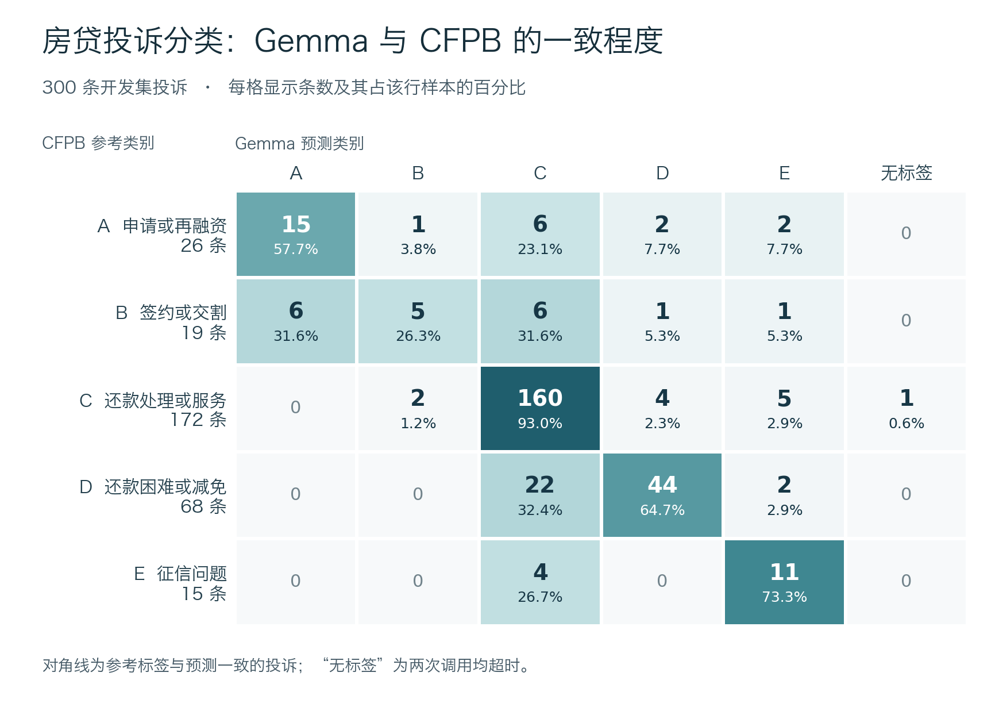

# Gemma 房贷投诉分类预实验 · 300 条

2026-11-22

从 2024 年 1 月的 CFPB 房贷投诉开发集中，按参考类别比例抽取 300 条（seed 42）。通过 SiliconFlow 国际站调用 `google/gemma-4-31B-it`，每次给一条投诉正文，请模型返回 A–E 中的一个字母。温度设为 0。[分类提示词](../../code/prompts/mortgage_v1.txt)

**准确率 78.3%（235/300），五类 macro-F1 为 0.645，有效标签率 99.7%（299/300）。** 64 条预测与 CFPB 参考标签不同，另有 1 条连续两次超时，计入准确率分母。在同一批样本上一律预测最多的 C 类，准确率为 57.3%。

- **B 类（签约或交割）的召回率最低。** 19 条中只识别出 5 条（26.3%），另有 6 条判为 A、6 条判为 C。这个类别样本少，一条投诉就对应约 5.3 个百分点。
- **最常见的分歧是 D → C。** 68 条参考标签为 D（还款困难或寻求减免）的投诉中，有 22 条被判为 C（还款处理或贷款服务）。相反方向只有 4 条。

这组分数衡量 Gemma 与 CFPB 参考标签在开发样本上的一致程度。后续评估蒸馏效果时，还需在同一批留出投诉上比较 Student 与 Teacher 的逐条预测。

[逐条预测](predictions.csv) · [完整指标](metrics.json) · [原始调用记录](../../output/gemma_dev_n300_s42_v1/run.sqlite)
