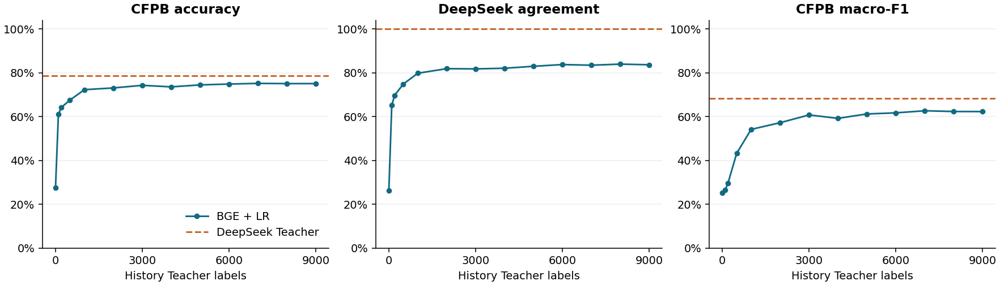
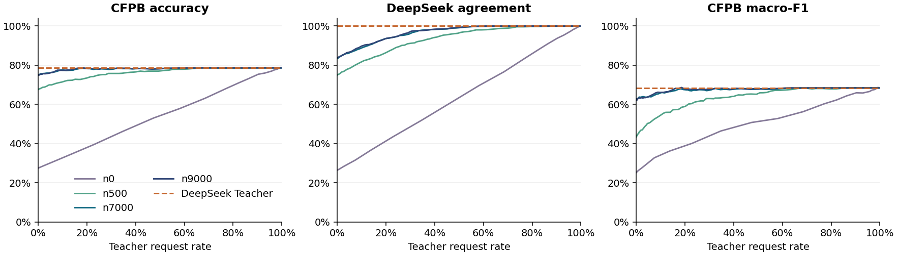
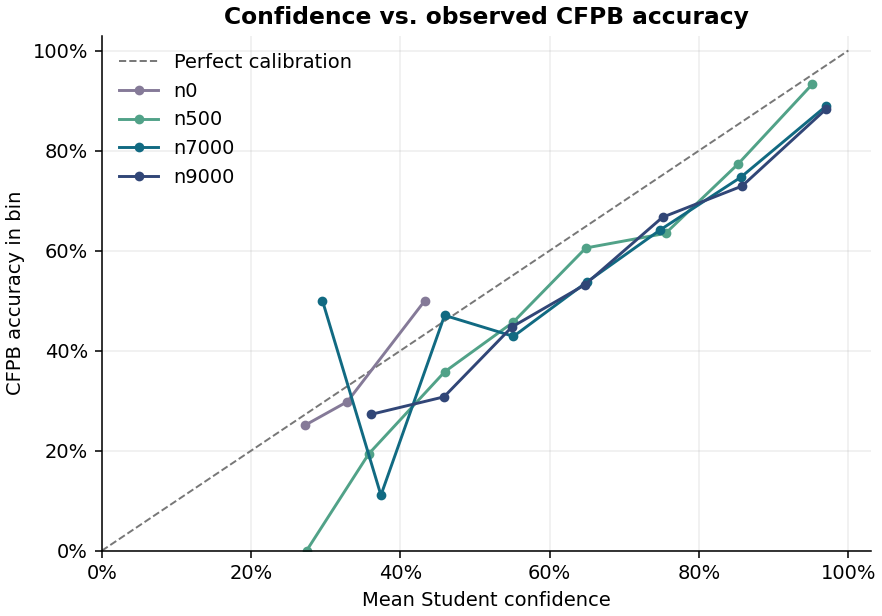

# BGE Small + LR 的 October validation 实验

在 **Quadro RTX 6000** 上完成 13 个节点，均使用相同的 **1,013 条** 2024 年 10 月验证样本。Student 的最高准确率为 **75.12%（n7000）**，最高 Teacher 一致率为 **83.91%（n8000）**，最高 macro-F1 为 **0.6264（n7000）**。DeepSeek Teacher 的准确率为 **78.58%**，macro-F1 为 **0.6833**。

## Embedding 与 LR 设计

- 冻结 `BAAI/bge-small-en-v1.5`，固定 revision `5c38ec7c405ec4b44b94cc5a9bb96e735b38267a`。它面向英语文本，输出 384 维向量，能以较低的编码开销作为轻量 Student 的基线。用投诉原文编码，将超过 510 个内容 token 的叙述按 510 个连续 token 分块。对每块的 `[CLS]` 向量做 L2 归一化，按块的内容 token 数加权，再做文档级 L2 归一化。编码只用投诉原文，输入不含标签、日期或 v3 few-shot 示例。[BGE 模型卡](https://huggingface.co/BAAI/bge-small-en-v1.5/tree/5c38ec7c405ec4b44b94cc5a9bb96e735b38267a)
- n0 使用 v3 的五段类别描述做零样本原型。类别权重为 `10 × 类别描述单位向量`，五个偏置均为 `0`。通过同一线性层与 softmax 输出标签和置信度。缩放系数在运行前固定。
- n100 至 n9000 各自独立拟合五分类 softmax LR。使用 L2 正则、`C=10`、L-BFGS、可学习截距和等样本权重。训练目标为冻结的 DeepSeek v3 标签。每个节点逐行核对同名 LoRA 训练前缀，reference 标签仅用于评估。验证期只计算预测与指标，11 至 12 月 test 未评分。CUDA 编码用 FP16，CLS 归一化和聚合用 FP32，LR 拟合在 CPU 上完成。
- 编码覆盖 9,000 条 history、1,013 条 validation 和 5 段类别描述，共 13,199 块，耗时 10.7 秒。validation 有 248 条使用多块，最长 6,852 个内容 token。13 份 JSON 可直接用 `softmax(x @ coef.T + intercept)` 恢复概率。

## Student 学习曲线

准确率与 macro-F1 按 CFPB 消费者自选标签计算。一致率以是否预测同一个合法 DeepSeek 字母为准。三个指标均基于整批验证样本。Teacher 有 1 条无效输出，计为错误及不一致。Macro-F1 对 A–E 五类的 F1 等权平均。

| 节点 | 准确率 | Teacher 一致率 | Macro-F1 | B 召回 | E 召回 |
|---:|---:|---:|---:|---:|---:|
| n0 | 27.44% | 26.36% | 0.2514 | 85.71% | 4.35% |
| n100 | 61.01% | 65.15% | 0.2642 | 0.00% | 0.00% |
| n200 | 64.17% | 69.69% | 0.2964 | 1.19% | 0.00% |
| n500 | 67.52% | 74.83% | 0.4324 | 2.38% | 36.96% |
| n1000 | 72.26% | 79.76% | 0.5415 | 7.14% | 54.35% |
| n2000 | 73.05% | 81.84% | 0.5719 | 10.71% | 56.52% |
| n3000 | 74.23% | 81.74% | 0.6073 | 19.05% | 56.52% |
| n4000 | 73.54% | 82.03% | 0.5918 | 14.29% | 56.52% |
| n5000 | 74.43% | 82.92% | 0.6118 | 20.24% | 56.52% |
| n6000 | 74.83% | 83.71% | 0.6169 | 22.62% | 54.35% |
| n7000 | 75.12% | 83.42% | 0.6264 | 23.81% | 56.52% |
| n8000 | 75.02% | 83.91% | 0.6230 | 25.00% | 58.70% |
| n9000 | 75.02% | 83.61% | 0.6227 | 25.00% | 56.52% |
| DeepSeek Teacher | 78.58% | 99.90% | 0.6833 | 41.67% | 67.39% |

- 从零样本到 n7000，准确率变化 **+47.68 个百分点**，macro-F1 变化 **+0.3750**。n7000 的 macro-F1 相对 Teacher 为 **-0.0569**。n9000 的准确率为 **75.02%**，macro-F1 为 **0.6227**。
- n0 在 1013 条投诉中预测了 694 次 B，而实际 B 类为 84 条。n100 则预测了 873 次 C，B 和 E 的召回分别为 0.00% 和 0.00%。n100 的 Teacher 标签里，C 占 65 条。
- n7000 的 B 类召回为 **23.81%**，E 类召回为 **56.52%**。验证集中 B 有 84 条，E 有 46 条。n7000 在 B/E 分别输出 25 / 38 次。分节点、分标签混淆矩阵与 Teacher 一致率见 `analysis.json`。

## 置信度与 Teacher 回退

置信度为 Student 五类 softmax 概率的最大值。`confidence < τ` 时回退到同一投诉的 DeepSeek 冻结预测，等于阈值时保留 Student。模拟覆盖 0 至 1 每隔 0.01 的阈值以及 0.995。τ=0 完全保留 Student，τ=1 在本实验中全部选择 Teacher。Teacher 无效输出保留为失败。模拟实际新增 Teacher API 调用为 0。

n7000 的正确与错误样本平均置信度分别为 **0.883** 和 **0.724**。按 10 个等宽分箱计算的 ECE 为 **0.094**，以置信度区分回答正确与否的 AUROC 为 **0.766**。最高置信度区间 `[0.9, 1]` 的 537 条样本平均置信度为 **96.97%**，实际准确率为 **88.83%**，说明输出概率偏高。

下表固定 Student 为 n7000，分别按准确率和 macro-F1 在各 Teacher 请求预算内挑选阈值。得分相同时优先选更少 Teacher 请求，再选较低阈值。“改正 / 改错”以同一条投诉的 Student 原输出为基准。

| 目标 | Teacher 预算 | 阈值 | Teacher 请求 | Hybrid 准确率 | 一致率 | Macro-F1 | 改正 / 改错 |
|---|---:|---:|---:|---:|---:|---:|---:|
| 准确率 | 10% | 0.56 | 93 (9.18%) | 77.39% | 88.25% | 0.6536 | 32 / 9 |
| Macro-F1 | 10% | 0.56 | 93 (9.18%) | 77.39% | 88.25% | 0.6536 | 32 / 9 |
| 准确率 | 25% | 0.66 | 185 (18.26%) | 78.38% | 92.79% | 0.6789 | 56 / 23 |
| Macro-F1 | 25% | 0.66 | 185 (18.26%) | 78.38% | 92.79% | 0.6789 | 56 / 23 |
| 准确率 | 50% | 0.66 | 185 (18.26%) | 78.38% | 92.79% | 0.6789 | 56 / 23 |
| Macro-F1 | 50% | 0.81 | 328 (32.38%) | 78.38% | 97.04% | 0.6814 | 76 / 43 |
| 准确率 | 100% | 0.97 | 699 (69.00%) | 78.58% | 99.90% | 0.6833 | 90 / 55 |
| Macro-F1 | 100% | 0.97 | 699 (69.00%) | 78.58% | 99.90% | 0.6833 | 90 / 55 |

- 最高 hybrid macro-F1 为 **0.6856**（n9000，τ=0.68，188 次 Teacher 请求，占 18.56%）。该点准确率为 **78.58%**，一致率为 **92.79%**，较纯 Teacher 的 macro-F1 高 **+0.0023**。
- 最高 hybrid 准确率为 **78.68%**（n500，τ=0.88，Teacher 请求率 68.02%）。比纯 Teacher 多答对 **1 条**。

回退到合法 Teacher 输出时直接计为一致。这里的最优点来自同一 October validation 的回顾性阈值搜索，仍需独立数据检验。

## 数据与复现

- [validation 指标](validation_metrics.csv)、[逐条 Student 预测与五类概率](predictions.csv)、[分标签指标和置信度分箱](analysis.json)
- [门控阈值全量汇总](gate_threshold_metrics.csv)、[分节点的预算搜索](gate_budget_summary.csv)、[代表性阈值和预算最优点的逐条路由](gate_predictions.csv.gz)
- [13 个节点参数](models/)、[运行配置、版本和源文件哈希](config.json)
