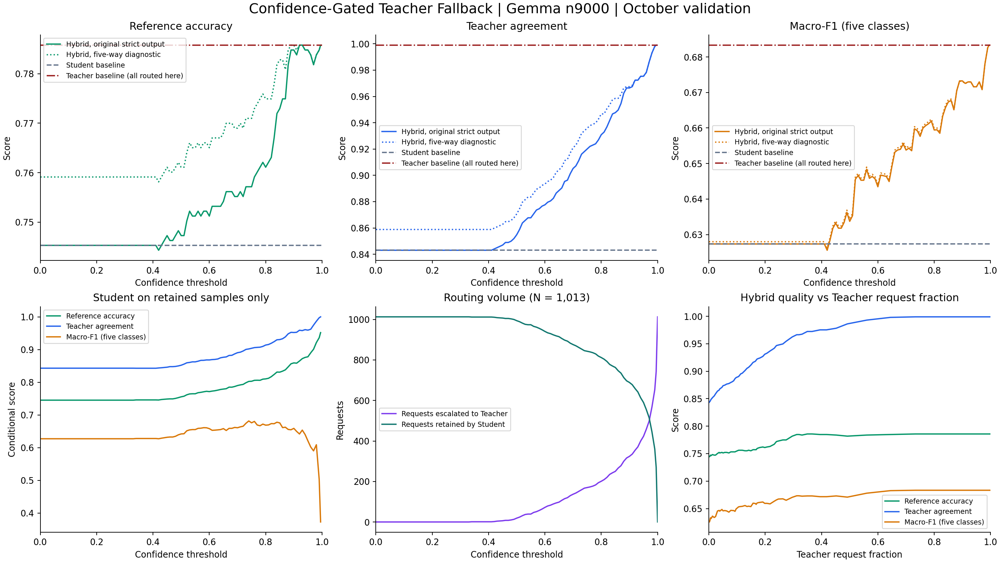
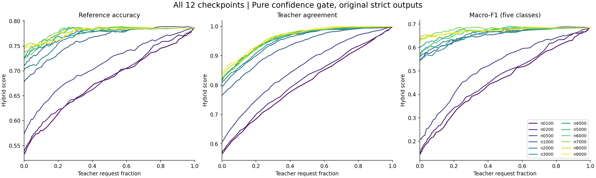

# CGTF：置信度门控 Teacher 回退实验

本实验按照“Student confidence 低于阈值则转发 Teacher，否则保留 Student”的规则，离线生成混合预测并重新评分。**方法命名为 Confidence-Gated Teacher Fallback（CGTF，置信度门控 Teacher 回退）；逐条融合记录命名为 CGTF Validation Ledger（CGTF 验证集融合记录）。** 名称描述本项目中的实验方法，不代表一种新提出的算法。

已完成 **12 个 Gemma checkpoint × 102 个阈值 × 2 种输出口径**，共 2,448 组指标。每组都对应同一批 **1,013 条 October validation**。本地 confidence 仅覆盖这些 validation 结果，不能称为全部 12,196 条 cohort 的模拟，也没有 Qwen confidence 结果。全部 Teacher 答案复用已有归档，**此次新增 Teacher API 调用数为 0**。

以 N9000 的原始严格输出为主结果：阈值 **0.80** 时，模拟转发 **201 条（19.84%）**，融合结果 Accuracy **76.11%**、Teacher Agreement **93.09%**、Macro-F1 **0.6594**。保留的 812 条 Student 请求上，Accuracy **81.03%**、Agreement **91.38%**，均高于全量 Student 基线。提高阈值会增加转发量，融合 Agreement 单调不减；Accuracy、Macro-F1 及保留子集的指标没有同样的单调保证。

## 1. 门控规则与记录结构

设第 i 条样本的 reference 为 `y_i`，Student 输出为 `s_i`，Teacher 输出为 `t_i`，Student confidence 为 `c_i`，阈值为 `τ`：

```text
escalate_i(τ) = 1[c_i < τ]
hybrid_i(τ)   = t_i,  当 c_i < τ
                s_i,  当 c_i ≥ τ
```

**等于阈值时保留 Student。** 路由只使用 confidence，不查看 reference、Teacher 标签或当前答案是否正确。低置信样本仍保留在完整 validation 中，只替换其最终输出；只有评估“Student 保留部分”时才把低置信样本排除。

主结果 `mode=strict` 使用已有 `strict_label`，失败为空值。这次严格遵循单一 confidence 规则：**不会因为空回复或低 label_mass 额外转发**。如果高置信 Student 为空，融合输出仍为空；如果转发后的 Teacher 失败，融合输出也为空，不偷偷退回 Student。

另提供 `mode=five_way` 对照，令 Student 输出为首 token A–E 最大概率字母。它更直接对应 confidence 的计算，但改变了原始严格生成的输出口径，不能与主结果混称。两种模式使用同一 confidence，因此同一 checkpoint、同一阈值的 Teacher 请求数完全相同。

每个导出的 CSV 含以下字段：

| 字段 | 含义 |
|---|---|
| `complaint_id`, `split`, `input_sha256` | 请求身份、分区和输入校验 |
| `mode`, `threshold` | 本条记录使用的 Student 输出口径和阈值 |
| `reference_label`, `teacher_label` | 原始 reference 与冻结 Teacher 标签 |
| `student_label`, `strict_label`, `five_way_label` | 当前 Student 输出及两种原始口径 |
| `confidence`, `label_mass` | A–E 内最大条件概率及 A–E 的完整词表概率总量 |
| `escalated_to_teacher`, `selected_source` | 是否升级、最终采用 Student 还是 Teacher |
| `final_label`, `final_status` | 融合输出；失败仍作为失败计分 |
| `label_changed` | 融合结果是否与原 Student 输出不同 |
| `teacher_attempts` | 该请求历史 Teacher 尝试次数；仅升级时计入模拟尝试量 |

**请求升级与标签变化是不同事件。** 一条低置信样本即使师生原本同标签，也计为一次 Teacher 请求。

## 2. 三项指标的定义与计算

### 2.1 融合记录：始终使用全量 N=1,013 作总体分母

**Accuracy** 衡量最终混合预测是否与 reference 一致：

`Accuracy_hybrid(τ) = Σ_i 1[hybrid_i(τ)=y_i] / N`。

无效输出按错误计，不删除这些样本。

**Agreement Rate** 指最终混合预测与冻结 Teacher 的一致率，与前述 consistency 是同一指标：

`Agreement_hybrid(τ) = Σ_i 1[hybrid_i(τ)=t_i 且 t_i 为合法 A–E] / N`。

双方都为空不算一致。Teacher 在这批 validation 有 1 条无效输出，所以全部回退 Teacher 时，按照原始“合法标签一致”口径，Agreement 是 **1,012/1,013=99.90%**，不是 100%。没有改用仅 Teacher 有效的 1,012 条作为主分母。

**Macro-F1** 以 reference 为真值，对 A–E 五类分别计算：

```text
TP_k = reference=k 且 final=k 的条数
FP_k = reference≠k 且 final=k 的条数
FN_k = reference=k 且 final≠k 的条数（包括 final 无效）
F1_k = 2 TP_k / (2 TP_k + FP_k + FN_k)
Macro-F1 = (F1_A + F1_B + F1_C + F1_D + F1_E) / 5
```

某类分母为零时 F1 记 0，与项目现有评分一致。不能把 Student 与 Teacher 的 Macro-F1 按覆盖率加权来得到融合 Macro-F1，必须先形成融合预测，再重算混淆矩阵。

### 2.2 过滤后的 Student：只评价保留集合

令 `R_τ={i:c_i≥τ}`，`N_retained=|R_τ|`：

```text
Accuracy_retained(τ)  = Σ_{i∈R_τ} 1[s_i=y_i] / N_retained
Agreement_retained(τ) = Σ_{i∈R_τ} 1[s_i=t_i 且 t_i 合法] / N_retained
Coverage_student(τ)  = N_retained / N
```

保留子集 Macro-F1 也重新构造五类混淆矩阵，固定对五类取平均。当保留集合为空时，三项分数均为 **未定义（CSV 留空）**，不能写成 0% 或 100%。这些是选中子集上的条件质量，不能表示 Student 的全量能力变强。

### 2.3 为什么融合 Agreement 会提高，而 Accuracy 不一定

每条成功回退的请求直接使用作为比较对象的 Teacher 标签，因此其 Teacher Agreement 按构造变为一致。可以直接核对：

`融合 Teacher 匹配数 = 保留部分 Student 匹配数 + 升级请求数 − 升级后 Teacher 无效数`。

阈值升高只会增加升级集合，对冻结 Teacher 的融合 Agreement 因而单调不减。但 Teacher 不保证比 Student 更接近 reference。记“Student 错而 Teacher 对”的升级数为 gains，“Student 对而 Teacher 错”的升级数为 losses，则：

`融合 reference 正确数 = 原 Student 正确数 + gains − losses`。

在 N9000、τ=0.80 时，gains=42、losses=26，因此正确数为 `755+42−26=771`，Accuracy 为 **771/1,013=76.11%**。Agreement 的提升不能单独证明分类正确性提高了同样的幅度。

## 3. 阈值曲线如何绘制

扫描 `τ=0.00, 0.01, …, 1.00`，另加 `0.995`，共 **102 个阈值**。从同一原始 Student/Teacher 预测独立生成每个阈值的融合结果，不把前一阈值的融合结果当作新的 Student。每个 checkpoint 分开评分。



图中六个面板分别展示：

1. 横轴阈值、纵轴全量融合 Accuracy。
2. 横轴阈值、纵轴全量融合 Teacher Agreement。
3. 横轴阈值、纵轴全量融合 Macro-F1。
4. 横轴阈值、纵轴保留 Student 子集的三项指标。
5. 横轴阈值、纵轴 Teacher 升级条数与 Student 保留条数。
6. 横轴 Teacher 升级比例、纵轴全量融合三项质量指标，便于后续与成本对接。

上排实线是主实验严格输出，点线是五选一诊断；水平参考线为纯 Student 与纯 Teacher。图为扫描点连线，没有做平滑；实际路由只在阈值跨过某个样本的 confidence 时改变。阈值 0 的升级数为 0。本次归档 confidence 均小于 1，故阈值 1 对应全部升级；规则本身仍规定 confidence 恰等于 1 时保留 Student。

## 4. N9000 的全量融合效果与 Teacher 请求数

主结果使用原始严格输出。所有分数均在相同的 1,013 条 validation 上计算。

| 阈值 τ | Teacher 请求数 | 升级比例 | 融合 Accuracy | 融合 Agreement | 融合 Macro-F1 |
|---|---:|---:|---:|---:|---:|
| 0.00（纯 Student） | 0 | 0.00% | 74.53% | 84.30% | 0.6274 |
| 0.60 | 72 | 7.11% | 75.12% | 87.76% | 0.6435 |
| 0.80 | 201 | 19.84% | 76.11% | 93.09% | 0.6594 |
| 0.90 | 324 | 31.98% | 78.48% | 96.64% | 0.6733 |
| 0.95 | 423 | 41.76% | 78.48% | 97.53% | 0.6716 |
| 0.99 | 653 | 64.46% | 78.48% | 99.80% | 0.6826 |
| 0.995 | 743 | 73.35% | 78.58% | 99.90% | 0.6833 |
| 1.00（本次全 Teacher） | 1,013 | 100.00% | 78.58% | 99.90% | 0.6833 |

从 τ=0.90 到 0.95，增加了 **99 次 Teacher 请求**，Agreement 从 96.64% 到 97.53%，Accuracy 不变，Macro-F1 从 0.6733 略降至 0.6716。这直接说明更多转发并不保证所有指标都提高。

τ=0.995 时，保留的 270 条 Student 输出已全部匹配 Teacher，所以与全 Teacher 得到相同最终预测；升级 743 条与升级 1,013 条的三项指标相同，但 Teacher 请求量不同。这是当前验证集的观察，不能据此保证未来完全等价。

本报告没有根据这些验证结果宣布一个最终最佳阈值。阈值选择需要下一步的质量约束与成本目标，并在独立数据上验证。

## 5. 过滤低置信度后，Student 自身是否更可靠

对 N9000，所列阈值下保留子集的 Accuracy 和 Agreement 都高于未过滤基线，表明 confidence 在这个 checkpoint 上有筛选作用。

| 阈值 τ | 保留 Student 条数 | 覆盖率 | 保留子集 Accuracy | 保留子集 Agreement | 保留子集 Macro-F1 |
|---|---:|---:|---:|---:|---:|
| 0.00 | 1,013 | 100.00% | 74.53% | 84.30% | 0.6274 |
| 0.60 | 941 | 92.89% | 77.15% | 86.82% | 0.6583 |
| 0.80 | 812 | 80.16% | 81.03% | 91.38% | 0.6689 |
| 0.90 | 689 | 68.02% | 85.92% | 95.21% | 0.6591 |
| 0.95 | 590 | 58.24% | 87.80% | 95.93% | 0.6208 |
| 0.99 | 360 | 35.54% | 93.61% | 99.72% | 0.5035 |
| 0.995 | 270 | 26.65% | 95.19% | 100.00% | 0.3730 |
| 1.00 | 0 | 0.00% | 未定义 | 未定义 | 未定义 |

**提高 Accuracy 与 Agreement 的代价是减少覆盖率，而且不保证 Macro-F1 提升。** τ=0.99 时，保留 360 条的 reference 分布为 A=8、B=2、C=283、D=63、E=4，Student 完全不预测 A/B。τ=0.995 时，reference 仍含 A=5、B=1、E=1，但 Student 只预测 C/D，所以 A/B/E 的 F1 均为 0，五类 Macro-F1 降至 0.3730。高置信筛选主要保留擅长的多数类，不能替代对全部类别的质量检查。

筛选收益也不是对所有 checkpoint 的保证。τ=0.80 时，12 个节点中 **11 个的保留子集 Accuracy 高于各自全量基线**，12 个的 Agreement 均提高；N0100 的 Accuracy 却从 53.31% 降到 **25/49=51.02%**，尽管 Agreement 从 56.56% 到 61.22%。早期模型的置信度可能集中在错误决策上，必须对每个 checkpoint 实测。

`threshold_metrics.csv` 同时保留低置信被转发集合上的原 Student 分数（`rejected_student_*`），以及高置信集合的各类 reference 支持数和预测数，方便进一步分析筛选是否偏向某些类别。

## 6. 严格输出、五选一与旧报告的区别

在 τ=0.80 时，两种 Student 口径都会转发 201 条：

| Student 输出口径 | 融合 Accuracy | 融合 Agreement | 融合 Macro-F1 | 保留子集 Accuracy | 保留子集 Agreement |
|---|---:|---:|---:|---:|---:|
| 原始严格生成（主结果） | 76.11% | 93.09% | 0.6594 | 81.03% | 91.38% |
| 首 token 五选一（诊断） | 77.49% | 94.67% | 0.6600 | 82.76% | 93.35% |

29 条原始 Student 空回复的 confidence 都高于 0.80，所以主规则把它们保留下来。τ=0.90 时还保留 3 条空回复；到 0.95 时才都被转发。五选一模式会为这些记录强制选字母，因此两者低阈值下有差距。

此前 [confidence 分析](../gemma3-270m-it-v3-confidence/note.md) 使用了额外条件“严格输出有效且 label_mass≥0.5”。其 τ=0.80 的示例会转发 **230 条**、全量 Agreement 为 **95.85%**。本次用户要求的是纯 confidence 门控，转发 **201 条**、全量 Agreement 为 **93.09%**。两者规则不同，不能把数字直接当成同一实验的复现差异。

## 7. 跨 checkpoint 比较：同时看质量与升级量



下表统一取 τ=0.80、原始严格输出。相同阈值不代表不同 checkpoint 有相同覆盖率，因此比较成本时必须使用实际升级数。

| Checkpoint | Teacher 请求数 | 融合 Accuracy | 融合 Agreement |
|---|---:|---:|---:|
| N0100 | 964 | 77.10% | 98.03% |
| N0200 | 901 | 76.80% | 95.85% |
| N0500 | 866 | 77.10% | 97.73% |
| N1000 | 483 | 77.20% | 95.06% |
| N2000 | 384 | 78.28% | 96.05% |
| N3000 | 297 | 76.90% | 94.27% |
| N4000 | 286 | 77.20% | 94.97% |
| N5000 | 217 | 77.99% | 92.99% |
| N6000 | 247 | 77.99% | 93.98% |
| N7000 | 211 | 78.08% | 92.50% |
| N8000 | 262 | 77.79% | 95.36% |
| N9000 | 201 | 76.11% | 93.09% |

N0100 的融合 Agreement 很高，但代价是 964/1,013 条都交给 Teacher，不能据此认定它比 N9000 的 Student 更好。相反，N9000 在同一阈值升级更少，却也留下更多分歧。下一步应比较“达到相同质量需要多少 Teacher 请求”，并纳入训练和 Student 推理成本。

## 8. 为成本分析保留的计数与计算关系

每个阈值记录：

```text
N_teacher(τ) = Σ_i 1[c_i < τ]
Teacher_request_rate(τ) = N_teacher(τ) / N
N_student_retained(τ) = N − N_teacher(τ)
Student_coverage(τ) = 1 − Teacher_request_rate(τ)
```

`student_requests` 始终为 **1,013**：必须先让 Student 处理请求并取得 confidence，才能决定是否升级。只有 Teacher 量随阈值变化，不能把保留 812 条误记为 Student 只推理了 812 次。

`teacher_requests` 是升级的独立请求数；`archived_teacher_attempts_on_escalated` 是这些 ID 在既有 Teacher 运行中包含重试的尝试数。两者与 `label_changed` 不同。例如：

| N9000 阈值 | 升级独立请求 | 历史 Teacher 尝试数 | 最终标签变化数 |
|---|---:|---:|---:|
| 0.80 | 201 | 201 | 89 |
| 0.90 | 324 | 325 | 125 |
| 0.95 | 423 | 424 | 134 |
| 0.99 | 653 | 654 | 157 |
| 1.00 | 1,013 | 1,014 | 158 |

τ=0.80 时还有 **112 条升级请求的标签不变**，仍然要计 Teacher 服务成本；不能只按 89 条变化标签计费。历史尝试数用于未来按原账本模拟重试，并不保证新的实时调用会有完全相同的尝试次数。

后续成本模型可以按以下组成计算：

`Cost_CGTF(τ) = C_train_amortized + C_student_all_N + C_confidence_and_gate + Σ_{升级请求 i} C_teacher_i`。

如果 Teacher 成本按 token 计费，应通过投诉 ID 关联历史账本中各次尝试的输入/输出 token 与约定价格。低置信请求可能更长，19.84% 请求量不必然对应 19.84% 的原 Teacher token 成本。本次没有填入假设单价，也没有报告未经核算的金额节省。

当前 confidence 是额外离线评分得到的；未来若从 Student 原有 forward 直接取 logits，应测量实际新增开销，不能把离线额外评分成本与未来集成服务成本混为一谈。全量回退时仍先运行 Student，因此与“直接调用 Teacher”具有相同最终质量，也不代表具有相同成本。

## 9. 输出文件与复现

| 文件 | 内容 |
|---|---|
| [threshold_metrics.csv](threshold_metrics.csv) | 12×102×2 共 2,448 行；全量融合、保留 Student、被拒绝 Student 的指标，以及升级量、标签变化、各类保留数量 |
| [summary.json](summary.json) | 方法、规则、阈值、原始基线、源文件 SHA-256 和实际新增 API 调用数 |
| [N9000 严格输出 τ=0.80 融合记录](n9000/strict/threshold_0p8.csv) | 1,013 条逐请求路由、原预测、Teacher 与最终输出 |
| [N9000 五选一 τ=0.80 对照记录](n9000/five_way/threshold_0p8.csv) | 相同门控下的五选一对照 |
| [threshold_curves.png](threshold_curves.png) | N9000 指标、筛选质量和升级量曲线 |
| [checkpoint_comparison.png](checkpoint_comparison.png) | 12 个 checkpoint 的质量—升级比例对照 |

每个 checkpoint 的 `strict/`、`five_way/` 目录均导出 **0、0.6、0.8、0.9、0.95、0.99、0.995、1** 八个阈值的完整融合记录，共 **192 份 CSV**。其余扫描阈值的指标在汇总表中；需要逐条记录时可追加 `--export-threshold` 重建，规则与统计完全相同。

从仓库根目录运行（只读取归档结果，不需要模型权重或 API 凭据）：

```bash
python3 -m unittest discover -s code -p 'test_confidence_gated_fallback.py'
MPLCONFIGDIR=/tmp/llm-jit-matplotlib python3 code/confidence_gated_fallback.py
# 额外导出一个阈值的逐条记录，例如 0.85：
MPLCONFIGDIR=/tmp/llm-jit-matplotlib python3 code/confidence_gated_fallback.py --export-threshold 0.85
```

统计代码使用 Python 标准库和项目现有 `evaluation.py`；画图需要 Matplotlib。可用 `--skip-plots` 仅重建统计和 CSV，或 `--output PATH` 写到独立目录。复跑会重建对应派生输出，不修改原始预测和 reference。

实现与检查：[模拟脚本](../../../code/confidence_gated_fallback.py)、[离线测试](../../../code/test_confidence_gated_fallback.py)。测试覆盖阈值相等、升级但标签不变、无效 Teacher 不算一致、保留空回复、空子集、手算五类 Macro-F1，以及路由不依赖参考答案。实际数据逐条核对 ID、输入哈希、reference、Teacher 标签、原始预测哈希和概率定义，并复算零门控基线、升级量和 Agreement 的单调性。

本实验是原独立 Student 评估后的离线扩展。阈值曲线描述这批 validation，筛选带来的高分不能称为全量 Student 能力提升；融合 Agreement 的提高部分是 Teacher 回退的直接结果。最终阈值、成本收益和对未来请求的效果，需要在冻结策略后独立验证。
