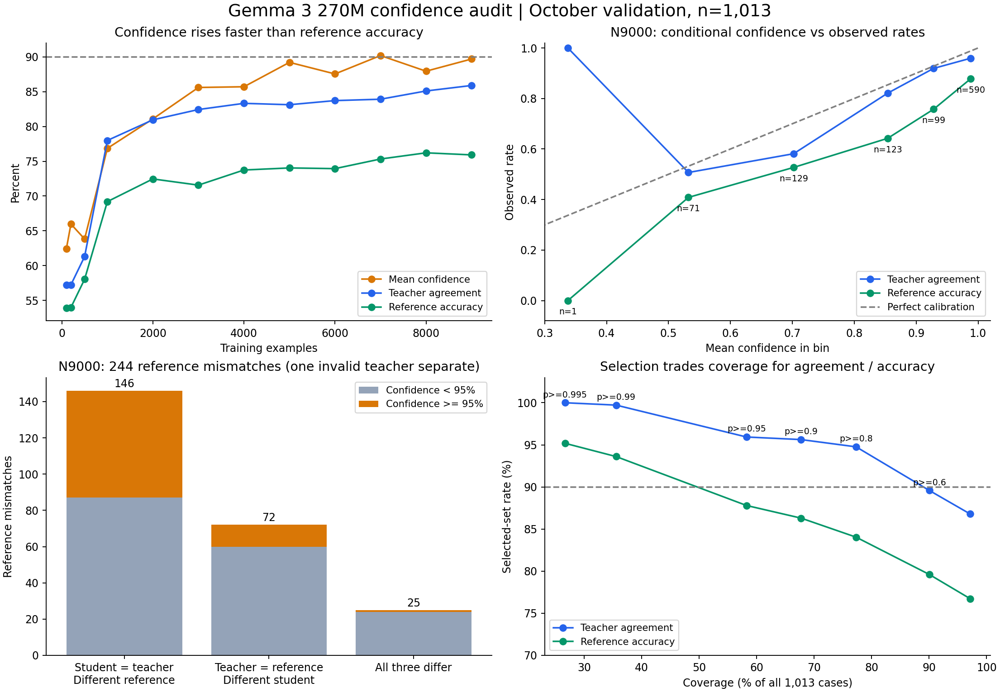

# Student confidence：为什么 accuracy 和 Teacher consistency 没有突破 90%

本次复算覆盖 **Gemma 3 270M IT 的全部 12 个 confidence 节点 × 同一批 1,013 条 October validation**。以 Teacher 一致率最高的 N9000 为主分析，N8000 及其他节点用于对照。当前目录没有 Qwen 的 confidence 结果，因此不能把下面的置信度结论直接推广到 Qwen。

主要发现是：**相对 reference 的错误中，大部分已经和 Teacher 一致；相对 Teacher 的分歧中，大部分集中在较低置信度样本。与此同时，少量非常自信的 Student 错判确实存在。** 所以“高置信错例可能标错、低置信错例可能是能力不足”是有用的复核线索，但不能直接据此给样本定性。

## 1. 先区分两个指标和两种输出口径

| 模型及口径 | Reference accuracy | Teacher consistency | 无效输出 |
|---|---:|---:|---:|
| N8000，严格自由生成 | 758/1,013 = 74.83% | 846/1,013 = 83.51% | 29 |
| N8000，首 token 五选一 | 772/1,013 = 76.21% | 862/1,013 = 85.09% | 强制选择 A–E |
| N9000，严格自由生成 | 755/1,013 = 74.53% | 854/1,013 = 84.30% | 29 |
| N9000，首 token 五选一 | 769/1,013 = 75.91% | 870/1,013 = 85.88% | 强制选择 A–E |
| DeepSeek Teacher | 796/1,013 = 78.58% | — | 1 |

本次 confidence 定义为 `max softmax(logit_A, …, logit_E)`，即只在 A–E 内重新归一化后的最大概率。它没有经过正确率校准，也没有考虑模型实际可能先输出终止符。除特别标为“严格自由生成”“部署筛选”的表格外，下文均用与 confidence 对应的首 token 五选一标签。

**Accuracy 和 consistency 的目标并不完全相容。** 设 S 为 Student，T 为 Teacher，Y 为冻结 reference。同一条样本若 T≠Y，S 不可能同时等于二者。因此在同一全量样本、同一 Student 输出和同一计分规则下：

`Accuracy(S,Y) + Consistency(S,T) ≤ 1 + Accuracy(T,Y) = 178.58%`。

这意味着，在当前冻结 Teacher 和 reference 下，**全量 accuracy 与 consistency 同时达到 90% 在数学上就不可行**；若 consistency 至少为 90%，accuracy 至多为 88.58%。这不是模型容量推测，而是标签分歧带来的约束。

若完美复现 Teacher 的输出及失败，reference accuracy 会是 78.58%。但 **78.58% 不是任意 Student 的准确率上限**：Student 可以纠正 Teacher 与 reference 的分歧，只是这类纠正会降低一致率。下面已经观察到 45 条这样的样本。

来源：[N9000 原始指标](../../../output/lora_eval/gemma3-270m-it_v3_n9000_validation/metrics.json)、[confidence 定义与计算代码](../../../code/student_confidence.py)、[既有数据集误差分析](../../../Dataset_Error_Analysis.md)。

## 2. 244 条 reference 错误，究竟来自哪里

| N9000 逐条关系 | 条数 | 平均 confidence | confidence ≥95% | confidence <80% |
|---|---:|---:|---:|---:|
| S=T=Y | 724 | 93.86% | 507 | 71 |
| S=T≠Y：师生相同，与 reference 不同 | 146 | 84.77% | 59 | 41 |
| T=Y≠S：Teacher 与 reference 相同，Student 不同 | 72 | 74.03% | 12 | 42 |
| S=Y≠T：Student 匹配 reference，Teacher 不同 | 45 | 75.50% | 11 | 26 |
| 三者为不同合法类别 | 25 | 68.22% | 1 | 21 |
| Teacher 无效，Student 也未匹配 reference | 1 | 85.79% | 0 | 0 |
| 合计 | 1,013 | 89.69% | 590 | 201 |

由此可以精确拆解：

- **Reference 错误 244 条 = 146 + 72 + 25 + 1。** 其中 **146/244=59.84%** 已经复现了 Teacher。进一步改善这 146 条上的蒸馏一致率不会提升 accuracy，因为一致率已经是 100%。需要复核 reference、Teacher 决策及分类规则。
- **Teacher 不匹配 143 条 = 72 + 45 + 25 + 1。** 其中 **89/143=62.24%** 的 confidence <80%。低置信区确实聚集了较多未复现 Teacher 的样本，但其中有 **26 条 Student 匹配 reference**，不能把所有低置信分歧都称为语义分类能力不足。
- 从 Teacher 的 796 条 reference 正确出发，Student 丢掉其中 72 条，又在 Teacher 不匹配 reference 的样本中追回 45 条，因此 **796−72+45=769**。这是 Teacher 与 Student accuracy 相差 2.67 个百分点的直接来源。
- confidence ≥95% 的 72 条 reference 错误中，**59 条师生一致**、12 条 Teacher 匹配 reference、1 条三方不同。59 条是优先复核 reference/规则的候选，不是 59 条已经确认的错标。

59 条高置信师生共同分歧中，有 **42 条在 N7000、N8000、N9000 三个节点上都与 Teacher 一致，且三个 confidence 均 ≥95%**。这增加了决策稳定性的证据，但同基座、同训练来源的 checkpoint 并非独立裁判，不能以投票方式确认 reference 错标。

即便假设这 59 条 reference 全部应改成师生共同标签，N9000 五选一 accuracy 也只是 `(769+59)/1013=81.74%`。这只是敏感性计算，不是修订建议，也不是对真实错标数量的估计。

## 3. 高置信错误，有错标线索，也有 Student 明显误判

以下是读取原始正文后的定性复核，依据冻结 v3 的“消费者想解决的主要问题”规则。案例按诊断目的挑选，不能用于估计全验证集的错标率；判断不是独立人工金标准。完整原文与标签保存在 [review_cases.csv](review_cases.csv)。

| 投诉 ID | Reference / Teacher / Student | Confidence | 正文关键证据与判断 |
|---|---|---:|---|
| 10413024 | D / C / C | 99.96% | 服务商重复收取强制保险费用；消费者明确表示每月能正常还款，争议是多收费用。按 v3，C 明显更贴近正文，D 是较强的 reference 复核候选。 |
| 10493179 | A / C / C | 99.93% | 要求服务商签署并退回房屋维修的保险赔款支票，没有新贷款申请或再融资诉求。C 比 A 更有正文依据。 |
| 10541399 | E / C / C | 99.94% | 起因是还款未入账，但消费者后续要求出具不会上报征信的确认信。C/E 都有文本依据；极高 confidence 仍不能排除 reference E 合理。 |
| 10375556 | B / B / C | 98.42% | 再融资交割文件错误未传达，导致放款和原贷款结清延迟。按 v3，交割/完成交易是主要问题，Student 被后续欠款、费用线索带到 C。是高置信 Student 错判的有力例子。 |
| 10510215 | B / B / C | 97.87% | 结算公司未正确向债权人付款、开错金额，让消费者处理交割款项。B 有直接依据；Student 高置信选择 C。 |
| 10611716 | B / E / C | 97.44% | 房屋已售、贷款已还清，明确要求删除信用报告上的逾期。按 v3 应偏 E；reference B 和 Student C 都不贴近最终诉求，Teacher 更合理。 |
| 10373136 | B / B / C | 42.78% | 买家承接 VA 贷款的手续反复拖延，投诉明确描述 closing delay。低置信 C 是 Student 对交易阶段边界掌握不足的例子。 |
| 10573688 | B / A / B | 49.36% | 再融资时承诺无费用，签署交割后余额增加并出现交割费用争议。Student 的 B 有正文依据；低 confidence 并不等于答案不合理。 |

这些案例支持三种机制同时存在：**reference 与正文主诉不一致、单标签/类别边界存在歧义、Student 自身判断错误**。高置信有助于给复核排序，但无法独立区分三者。Student 又是由 Teacher 标签训练出来的，“Teacher 也这样判”本身带有共同偏差。

既有 [Dataset_Error_Analysis.md](../../../Dataset_Error_Analysis.md) 还记录了 v3 与原始分类口径的差异，尤其是 B/C 的交割后费用和账户管理边界；本次 confidence 结果与这种解释相容，但没有通过新 prompt 对照实验识别因果贡献。

## 4. Consistency 的主要短板：类别边界和少数类，而非只有输出格式

以 Teacher 标签为分组依据，N9000 首 token 五选一的一致情况如下。这里的分母与 reference 召回率不同。

| Teacher 类别 | Teacher 样本数 | Student 一致数 | 类内一致率 | N9000 训练中的该类 Teacher 标签数 |
|---|---:|---:|---:|---:|
| A 申请/再融资 | 85 | 65 | 76.47% | 720（8.00%） |
| B 签约/交割 | 43 | 21 | 48.84% | 246（2.73%） |
| C 现有贷款管理 | 598 | 555 | 92.81% | 5,387（59.86%） |
| D 还款困难/救济 | 232 | 198 | 85.34% | 2,187（24.30%） |
| E 征信 | 54 | 31 | 57.41% | 460（5.11%） |

**B、E 没有充分复现 Teacher**：不是 reference 定义差异就能解释的，因为这里直接对比 Teacher。B 的 22 条不匹配主要去 C（14）和 A（8）；E 的 23 条不匹配主要去 C（14）。与此同时，Teacher C→Student D 有 28 条，D→C 有 33 条，合计 **61/143=42.66%** 的 Teacher 不匹配。

训练标签 C+D 合占 **84.16%**，B 只有 246 条。少数类学习不足、C 的过度吸收，以及多诉求下的边界判断，都是值得优先验证的解释。仅凭本实验不能断定“270M 容量是根因”，因为训练采样、优化、prompt 边界和模型容量没有被分别控制。

Reference 口径下，C↔D 有 92 条错误；B→C 有 36 条、B→A 有 19 条。Teacher 自己在 reference B 上也只匹配 35/84=41.67%，说明 B 的低 accuracy 同时包含 Teacher/reference 分歧和额外蒸馏损失。

**输出失败只解释一部分差距。** 29 条严格生成失败的 A–E 总概率 `label_mass` 仅 **5.37×10⁻⁷ 至 7.39×10⁻⁶**，但在 A–E 内归一化后，confidence 仍有 **80.55%–91.38%**。合法输出的 label_mass 中位数则为 99.94%。因此需要同时看 confidence、label_mass 和实际输出有效性。

改用五选一只多匹配 Teacher 16 条、多匹配 reference 14 条，分别增加 **1.58、1.38 个百分点**，仍只有 85.88%、75.91%。即使用冻结 Teacher 标签回填这 29 条、其余预测不变，也只有 28 条能恢复有效一致（另 1 条 Teacher 也无效），一致率为 **882/1,013=87.07%**；若全部得到 reference 标签，accuracy 最多为 **784/1,013=77.39%**。输出修复有价值，但单独做它无法达到 90%。

## 5. Confidence 有区分力，但对 reference 明显过于自信

| N9000 confidence 区间 | 样本数 | 平均 confidence | Reference accuracy | Teacher consistency |
|---|---:|---:|---:|---:|
| <60% | 72 | 52.94% | 40.28% | 51.39% |
| 60%–80% | 129 | 70.21% | 52.71% | 58.14% |
| 80%–90% | 123 | 85.39% | 64.23% | 82.11% |
| 90%–95% | 99 | 92.82% | 75.76% | 91.92% |
| ≥95% | 590 | 98.80% | 87.80% | 95.93% |

高置信样本整体更可靠，但 **平均 confidence 98.80% 的那组，reference accuracy 只有 87.80%**，与 Teacher 的一致率则达到 95.93%。这说明 confidence 更接近“模型学到的 Teacher 决策有多确定”，不能直接解释为“reference 正确概率”。

N9000 全体平均 confidence 为 **89.69%**，reference accuracy 为 **75.91%**，相差 **13.77 个百分点**。采用原始六个固定分箱（0/.4/.6/.8/.9/.95/1）计算的 ECE，相对 reference 为 **13.77 个百分点**，相对 Teacher 一致事件为 **3.93 个百分点**。这里只是这批验证数据上的分箱校准诊断，且最低箱只有 1 条；不是对未来概率精度的保证。

训练规模趋势也表明，提高 certainty 不等于同幅度提高 accuracy：

| 训练条数 | 五选一 accuracy | 五选一 consistency | 全体平均 confidence | Reference 错例平均 confidence |
|---|---:|---:|---:|---:|
| 100 | 53.90% | 57.26% | 62.44% | 60.86% |
| 200 | 54.00% | 57.26% | 65.98% | 63.84% |
| 500 | 58.05% | 61.30% | 63.83% | 58.34% |
| 1,000 | 69.20% | 77.99% | 76.85% | 65.80% |
| 2,000 | 72.46% | 80.95% | 81.09% | 68.45% |
| 3,000 | 71.57% | 82.43% | 85.59% | 74.46% |
| 4,000 | 73.74% | 83.32% | 85.70% | 74.05% |
| 5,000 | 74.04% | 83.12% | 89.20% | 78.98% |
| 6,000 | 73.94% | 83.71% | 87.54% | 76.13% |
| 7,000 | 75.32% | 83.91% | 90.18% | 79.95% |
| 8,000 | 76.21% | 85.09% | 87.93% | 78.23% |
| 9,000 | 75.91% | 85.88% | 89.69% | 79.91% |

从 N2000 到 N9000，accuracy 增加 **3.46 个百分点**，错例的平均 confidence 却增加 **11.46 个百分点**。这与模型对部分系统性分歧越来越确定相符；各节点错误集合会变化，训练样本与优化步数也同时增加，因此不能单凭这些均值证明同一批错误持续过拟合。

## 6. 能否利用 confidence 得到超过 90% 的表现

可以在部分样本上达到，但必须报告覆盖率。下表要求实际严格输出有效、`label_mass≥0.5`，再按 confidence 筛选；这里的阈值是探索性分析，并未作为独立测试集结论。

| Confidence 门槛 | Student 接管数 | 全量覆盖率 | 接管部分 reference accuracy | 接管部分 Teacher consistency |
|---|---:|---:|---:|---:|
| ≥60% | 912 | 90.03% | 79.61% | 89.58% |
| ≥80% | 783 | 77.30% | 84.04% | 94.76% |
| ≥90% | 686 | 67.72% | 86.30% | 95.63% |
| ≥95% | 590 | 58.24% | 87.80% | 95.93% |
| ≥99% | 360 | 35.54% | 93.61% | 99.72% |

因此，这组结果支持 **“用 confidence 做 JIT 分流”** 的下一步实验。≥80% 且有效输出时，Student 可覆盖 77.30% 的样本，接管部分对 Teacher 一致率为 94.76%。其余回退到已归档 Teacher 标签的离线模拟中，全量一致率为 **971/1,013=95.85%**，全量 reference accuracy 为 **794/1,013=78.38%**。

这是组合系统的离线结果，不能称为 Student 全量能力达到 95.85%；回退 Teacher 的一致性是按构造获得的，且假设可取得同一冻结 Teacher 输出，不包含新 API 调用波动、时延或费用。≥99% 的子集两项都超过 90% 也不违反第 1 节约束，因为筛选改变了样本集合与 Teacher-reference 的匹配率。

## 7. 下一步实验应分别回答什么

1. **确定 reference 分歧的性质。** 从“高置信师生共同分歧”“低置信 Teacher/reference 一致但 Student 错”“高置信 Student 单独错”“低置信但 Student/reference 一致”和全一致对照中分层抽样。隐藏模型输出后按明确规则独立复核，保留“歧义/信息不足”选项。高置信共同分歧的 59 条可作为优先复核池；估计全体验证集错标率必须按抽样权重汇总，不能直接把池内比例外推。不要按 confidence 自动改 reference。
2. **提高全量 consistency。** 针对 history 中 B/E 与 C/D、B/C、A/B、C/E 边界补充或重采样训练例，并用与 validation 无重叠的数据构建对照。确认改变是改善这些类的一致率，还是只把 C 的错误转移到其他类。原始 reference 的修订本身不会改变 S 与 T 的一致率。
3. **提高 reference accuracy。** 先确定任务到底要复现原表单类别还是按 v3 重判主诉，再决定是否补充类别规则、重建经裁决的标签或更新 Teacher。继续单纯拟合当前 Teacher，并不能合理期待同一全量集合上两项同时 ≥90%。保留冻结 reference 得分与新裁决标签得分两套口径，避免把改标签造成的提升误记为模型能力提升。
4. **利用 confidence 控制部署范围。** 在独立校准数据上选择接管阈值，同时考虑 label_mass/有效输出，冻结后再评估留出的测试集。概率校准可以改善 confidence 的解释与分流，但不会自动改变 argmax 分类、提升原始全量 accuracy。

当前证据能明确定位错误构成和复核优先级；尚不能精确估计“多少百分比由 reference 错标、prompt 差异、Teacher 错误或 Student 容量不足造成”。这需要独立裁决与受控实验。

## 复现与核验

运行 `MPLCONFIGDIR=/tmp/llm-jit-matplotlib python3 code/analyze_student_confidence.py`。脚本只读取已归档结果，不进行模型推理、不修改原始标签或预测；重建本目录的分析 JSON、复核 CSV 与图。

已逐条检查 12,156 条 confidence 记录的 ID、reference、Teacher 标签、归档预测哈希、首 token 选择、五类概率之和与最大值，并复算 accuracy 和 consistency，与原始 summary/metrics 一致。N9000 history 与 validation ID 无交集。Teacher 的 1 条无效输出始终按不匹配计入全量分母。图已渲染并检查。复核 CSV 含 302 条需要查看的记录，包括所有三方分歧及严格输出失败，保留原始正文以便核查。

[派生统计及源文件 SHA-256](analysis.json) · [逐条复核表](review_cases.csv) · [可复现分析脚本](../../../code/analyze_student_confidence.py) · [原始 confidence 结果](../../../output/confidence/gemma3-270m-it-v3-lora-curve/n9000/summary.json)
