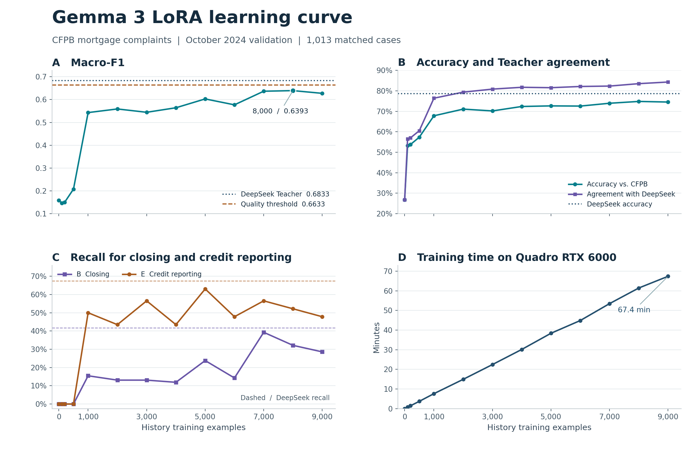

# Gemma 3 270M IT LoRA 的 October validation 学习曲线

全部 **12 个 LoRA 节点**都在相同的 1,013 条 2024 年 10 月 CFPB 房贷投诉上完成评估。**8,000 条取得最高准确率 74.83% 和最高 macro-F1 0.6393**。它比未微调 Gemma 3 多答对 487 条，离 DeepSeek Teacher 的得分差 0.0440，离项目预设的 **0.6633** 门槛还差 **0.0240**。按预设门槛，12 个节点的达标数为 **0**。 [实验设计](../../../Experiment%20Design.md) · [DeepSeek 分区报告](../../teacher_deepseek-v4.1-flash-1017_all/note.md)

图中 0 条代表未微调的 Gemma 3。横轴是累计获得的合法 history Teacher 标签数。B 表示签约或交割，E 表示征信及相关服务。

## 全部节点

主要结果采用自由生成，最终无效输出计错，分母为全部 1,013 条。准确率和 macro-F1 以 CFPB 的消费者自选标签为参照。Teacher 一致率衡量是否和 DeepSeek 输出同一个合法字母，分母同为 1,013。固定预测 history 多数类 C 用于衡量类别不平衡下的准确率基准。

| 训练条数 | 前缀截止日 UTC | 正确数 | 准确率 | Macro-F1 | 有效率 | Teacher 一致率 | 训练用时 |
| --- | --- | ---: | ---: | ---: | ---: | ---: | ---: |
| [未微调](../../../output/baseline_v3/student_gemma3-270m-it_validation_cuda_run3/metrics.json) | — | 271 | 26.75% | 0.1591 | 83.61% | 26.75% | — |
| [100](../../../output/lora_eval/gemma3-270m-it_v3_n0100_validation/metrics.json) | 2024-01-04 | 540 | 53.31% | 0.1463 | 97.14% | 56.56% | 46 秒 |
| [200](../../../output/lora_eval/gemma3-270m-it_v3_n0200_validation/metrics.json) | 2024-01-08 | 545 | 53.80% | 0.1504 | 97.14% | 57.06% | 1 分 27 秒 |
| [500](../../../output/lora_eval/gemma3-270m-it_v3_n0500_validation/metrics.json) | 2024-01-18 | 581 | 57.35% | 0.2078 | 97.14% | 60.51% | 3 分 42 秒 |
| [1,000](../../../output/lora_eval/gemma3-270m-it_v3_n1000_validation/metrics.json) | 2024-02-01 | 687 | 67.82% | 0.5430 | 97.14% | 76.41% | 7 分 36 秒 |
| [2,000](../../../output/lora_eval/gemma3-270m-it_v3_n2000_validation/metrics.json) | 2024-02-28 | 720 | 71.08% | 0.5589 | 97.14% | 79.37% | 14 分 54 秒 |
| [3,000](../../../output/lora_eval/gemma3-270m-it_v3_n3000_validation/metrics.json) | 2024-03-27 | 711 | 70.19% | 0.5443 | 97.14% | 80.85% | 22 分 26 秒 |
| [4,000](../../../output/lora_eval/gemma3-270m-it_v3_n4000_validation/metrics.json) | 2024-04-24 | 733 | 72.36% | 0.5642 | 97.14% | 81.74% | 30 分 07 秒 |
| [5,000](../../../output/lora_eval/gemma3-270m-it_v3_n5000_validation/metrics.json) | 2024-05-28 | 736 | 72.66% | 0.6029 | 97.14% | 81.54% | 38 分 22 秒 |
| [6,000](../../../output/lora_eval/gemma3-270m-it_v3_n6000_validation/metrics.json) | 2024-06-30 | 735 | 72.56% | 0.5770 | 97.14% | 82.13% | 44 分 51 秒 |
| [7,000](../../../output/lora_eval/gemma3-270m-it_v3_n7000_validation/metrics.json) | 2024-07-31 | 749 | 73.94% | 0.6366 | 97.14% | 82.33% | 53 分 28 秒 |
| [8,000](../../../output/lora_eval/gemma3-270m-it_v3_n8000_validation/metrics.json) | 2024-08-28 | 758 | 74.83% | 0.6393 | 97.14% | 83.51% | 1 小时 01 分 26 秒 |
| [9,000](../../../output/lora_eval/gemma3-270m-it_v3_n9000_validation/metrics.json) | 2024-09-25 | 755 | 74.53% | 0.6274 | 97.14% | 84.30% | 1 小时 07 分 23 秒 |
| 固定预测 C | — | 562 | 55.48% | 0.1427 | 100.00% | — | — |
| DeepSeek Teacher | — | 796 | 78.58% | 0.6833 | 99.90% | — | — |

训练用时取自各适配器的 `training.json`，统计从开始优化到训练结束的耗时。每个节点独立从同一 Gemma 3 基座开始。训练使用 Quadro RTX 6000、FP32、rank 8、alpha 16、dropout 0.05、`q_proj`/ `v_proj`、学习率 2e-4、3 个 epoch、有效 batch 8 和 seed 42。Validation 统一用 CUDA / FP32、v3 提示词和贪心自由生成。 [派生统计与源文件校验值](analysis.json)

## 随训练规模变化的表现

- **100–500 条**。100 和 200 条组的 C 预测分别占 94.87% 和 95.56%，macro-F1 都低于未微调的 0.1591。500 条开始召回更多 D，准确率比固定预测 C 高 1.88 个百分点，合法输出仍只有 C 和 D。
- **500 到 1,000 条是最大的相邻增幅**。准确率提高 10.46 个百分点，macro-F1 上升 **0.3353**。1,000 条是第一个五类召回均大于零的实测节点，取得了从未微调到 8,000 条所见 macro-F1 增益的约 **80%**，训练用时 7 分 36 秒。
- **2,000 到 6,000 条的准确率上升较慢，类别表现有波动**。例如 4,000 到 5,000 条只多答对 3 条，但 B 类从答对 10 条升到 20 条，E 类从 20 条升到 29 条，macro-F1 提升 0.0387。6,000 条的 B、E 召回回落，macro-F1 降到 0.5770。
- **7,000 到 9,000 条的差距较小**。7,000 条比 8,000 条少训练 **7 分 58 秒**，macro-F1 只差 **0.0026**。9,000 条的训练 loss 最低（0.1491），Teacher 一致率最高（84.30%），C、B 和 E 的参考标签命中数低于 8,000 条，综合 macro-F1 回落到 0.6274。随着前缀扩张，新增投诉内容和优化步数同时变化，这组实验衡量的是各启动点下整套训练方案的结果。

### 验证集配对差值

对同一批投诉配对重采样 2,000 次（seed 42），以百分位数给出探索性 95% 区间。区间描述这些固定 adapter 在样本重采样下的差异，训练种子只测了 42。

| 比较 | Macro-F1 差值 | 配对 95% 区间 |
| --- | ---: | ---: |
| 1,000 − 500 | +0.3353 | [+0.2872, +0.3783] |
| 5,000 − 4,000 | +0.0387 | [+0.0054, +0.0753] |
| 6,000 − 5,000 | -0.0259 | [-0.0592, +0.0052] |
| 7,000 − 6,000 | +0.0597 | [+0.0248, +0.0961] |
| 8,000 − 未微调 | +0.4802 | [+0.4325, +0.5242] |
| 8,000 − 7,000 | +0.0026 | [-0.0262, +0.0307] |
| 8,000 − 9,000 | +0.0119 | [-0.0084, +0.0331] |
| 8,000 − DeepSeek | -0.0440 | [-0.0839, -0.0065] |

1,000 条相对 500 条的提升在重采样下保持明显。8,000 条与 7,000 条、9,000 条的间距都小，两个配对区间均跨过零。8,000 条是这批 validation 上的最高点，相邻节点的实际差距需要结合这一区间理解。门槛判定使用预设的观察分数。

## 类别表现

| 类别 | A | B | C | D | E |
| --- | --- | --- | --- | --- | --- |
| 含义 | 申请或再融资 | 签约或交割 | 管理现有贷款 | 还款困难或救济 | 征信及相关服务 |
| Validation 支持数 | 106 | 84 | 562 | 215 | 46 |

下表为各节点召回率。

| 训练条数 | A | B | C | D | E |
| --- | ---: | ---: | ---: | ---: | ---: |
| 未微调 | 17.92% | 0.00% | 32.92% | 31.16% | 0.00% |
| 100 | 0.00% | 0.00% | 95.55% | 1.40% | 0.00% |
| 200 | 0.94% | 0.00% | 96.26% | 1.40% | 0.00% |
| 500 | 0.00% | 0.00% | 95.02% | 21.86% | 0.00% |
| 1,000 | 42.45% | 15.48% | 79.54% | 73.95% | 50.00% |
| 2,000 | 49.06% | 13.10% | 87.90% | 66.51% | 43.48% |
| 3,000 | 39.62% | 13.10% | 86.65% | 67.44% | 56.52% |
| 4,000 | 50.94% | 11.90% | 89.68% | 67.44% | 43.48% |
| 5,000 | 55.66% | 23.81% | 85.41% | 68.84% | 63.04% |
| 6,000 | 60.38% | 14.29% | 83.10% | 79.07% | 47.83% |
| 7,000 | 47.17% | 39.29% | 87.37% | 69.30% | 56.52% |
| 8,000 | 54.72% | 32.14% | 87.01% | 74.42% | 52.17% |
| 9,000 | 56.60% | 28.57% | 86.12% | 76.74% | 47.83% |
| DeepSeek Teacher | 56.60% | 41.67% | 89.32% | 78.14% | 67.39% |

- **B 最难**。7,000 条的 B 召回率最高，答对 33/84（39.29%），接近 Teacher 的 35/84（41.67%）。8,000 条答对 27 条，9,000 条答对 24 条。8,000 条最常把 B 判为 C（31 条）或 A（19 条）。
- **E 的最好召回率出现在 5,000 条**，答对 29/46（63.04%），但共预测出 63 条 E，精确率为 46.03%。7,000 条把精确率提高到 60.47%，因此 E 类 F1 在 7,000 条最高（0.5843）。
- **8,000 条与 Teacher 的 macro-F1 差值约有 73% 来自 B 和 E**。同一批样本中，双方都答对 710 条，只有 8,000 条 adapter 答对 48 条，只有 Teacher 答对 86 条。Teacher 一致率和参考标签准确率反映不同的比较目标。

### 8,000 条的混淆矩阵

行是 CFPB 参考类别，列是 Student 最终输出。FAIL 表示两次尝试均为空回复。

| CFPB 参考 | A | B | C | D | E | FAIL |
| --- | ---: | ---: | ---: | ---: | ---: | ---: |
| A | 58 | 6 | 24 | 13 | 3 | 2 |
| B | 19 | 27 | 31 | 3 | 2 | 2 |
| C | 2 | 6 | 489 | 44 | 7 | 14 |
| D | 3 | 0 | 41 | 160 | 2 | 9 |
| E | 0 | 0 | 15 | 5 | 24 | 2 |

C 与 D 双向混淆共 85 条，占 255 条未答对样本的三分之一。B→C 另有 31 条，E→C 有 15 条。

## 空回复与首 token 诊断

全部 12 个 adapter 的有效输出率均为 **97.14%**。同样的 **29 条**投诉在所有节点上两次生成都为空，全部来自未微调时的 166 条空回复。其余 137 条从 100 条节点起已经恢复为合法字母。各节点的重试均未带来额外恢复，后续学习曲线的变化来自分类结果。

8,000 条节点在这 29 条上用 A–E 首 token 五选一可以答对 14 条，准确率到 **76.21%**，macro-F1 到 **0.6399**。这是候选字母诊断的结果。进一步假设 29 条空回复全部改成正确标签、另外 984 条输出保持原样，8,000 条节点的 macro-F1 上限是 **0.6617**，仍低于门槛 **0.6633**。因此，即便解决这些空回复，达到门槛还需要改进至少一部分合法输出的分类。 [逐条失败 ID 与诊断统计](analysis.json)

## 训练时间与实验结论

训练吞吐为 **6.51–6.87 条次/秒**（把每个 epoch 中看到的同一投诉各算一次），因此用时基本随样本数增长。12 个节点的累计训练用时 **5 小时 46 分 29 秒**。各节点在 1,013 条 validation 上累计推理尝试时间为 83.74–86.80 秒。单个节点的训练用时适用于比较该启动点的计算开销，完整部署时间还需加上验证、加载及流量回放的等待。

按整个任务的 macro-F1，8,000 条是当前最佳验证点。7,000 条在更短的训练时间下得分接近，同时有最高的 B 类召回。9,000 条更接近 Teacher 的逐条标签选择。预设的选择规则要求先达到质量门槛，因此本轮的正式结论是 **无达标节点**。

## 可核对的来源

所有适配器的训练 CSV 与已接受的 history Teacher 标签逐条匹配，训练数据与 validation 投诉 ID 无重叠。训练记录逐条核对了两个监督 token，即 Teacher 字母和 Gemma 的 `<end_of_turn>`。用只读 SQLite 和预测导出复算全部指标，核对了 13 个 Student 运行的相同验证清单、参考标签、输入哈希及 Teacher 标签。训练与评估登记的 adapter 哈希一致，已同步的 adapter 配置文件也通过哈希核验。权重本体由 GPU 服务器保留，本地核验范围覆盖运行记录和配置。 [完整派生数据](analysis.json) · [训练前缀清单](../../../data/lora/teacher_deepseek-v4.1-flash-1017_v3/manifest.json) · [未微调基线报告](../gemma3-270m-it-v3-cuda/note.md)
