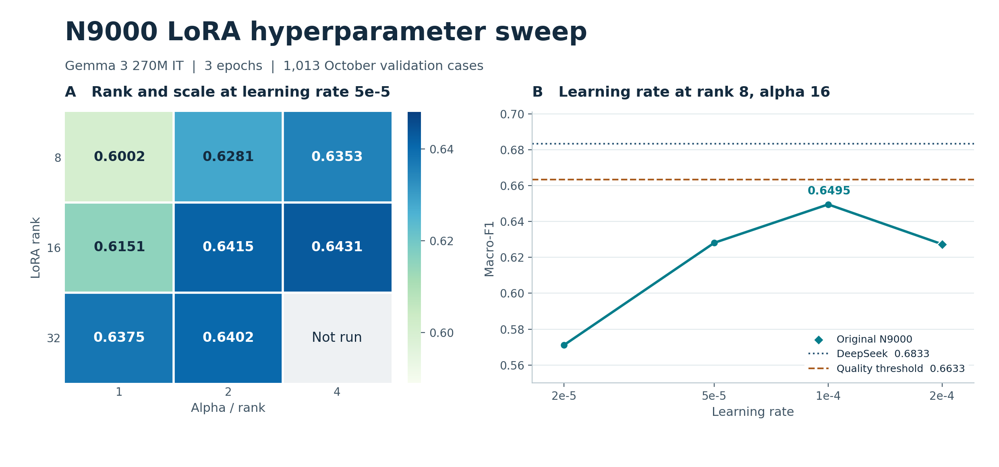

# Gemma 3 N9000 LoRA 超参实验

在相同的 9,000 条训练数据和 3 个 epoch 下，**rank 8、alpha 16、学习率 `1e-4`** 在 10 组中取得最高 October validation macro-F1，**0.6495**。相比原 N9000 的 0.6274，提高 **0.0222**，准确率从 74.53% 升至 **75.22%**。本轮没有组合达到项目预设的 **0.6633** 门槛，最优点还差 **0.0138**。 [实验门槛](../../../Experiment%20Design.md) · [上一轮学习曲线](../gemma3-270m-it-v3-lora-curve/note.md)

## 对照条件和全部结果

10 组分别从同一版本的原始 Gemma 3 270M IT 新建 LoRA，使用同一个 9,000 条 history Teacher 标签前缀。固定 Quadro RTX 6000、FP32、`q_proj` 和 `v_proj`、dropout 0.05、AdamW、有效 batch 8、micro-batch 1、seed 42 和 3 个 epoch，每组都是 3,375 次更新。只改变 rank、alpha 和学习率。 [运行脚本](../../../student_lora.sh)

所有版本在相同的 **1,013 条 2024 年 10 月 validation** 上使用 v3 提示词和贪心自由生成。准确率和五类等权 macro-F1 以 CFPB 参考标签为准，最终无效输出计错。Teacher 一致率是全样本中双方给出同一合法字母的比例。

| 组别 | Rank | Alpha | 学习率 | 正确数 | 准确率 | Macro-F1 | Teacher 一致率 | 末轮训练 loss | 训练用时 |
| --- | ---: | ---: | ---: | ---: | ---: | ---: | ---: | ---: | ---: |
| [1](../../../output/lora_eval/gemma3-270m-it_v3_n9000_r8_a16_lr5e-5_e3_drop0.05_validation/metrics.json) | 8 | 16 | `5e-5` | 751 | 74.14% | 0.6281 | 82.53% | 0.1949 | 1 小时 09 分 21 秒 |
| [2](../../../output/lora_eval/gemma3-270m-it_v3_n9000_r16_a32_lr5e-5_e3_drop0.05_validation/metrics.json) | 16 | 32 | `5e-5` | 756 | 74.63% | 0.6415 | 83.12% | 0.1754 | 1 小时 10 分 14 秒 |
| [3](../../../output/lora_eval/gemma3-270m-it_v3_n9000_r32_a64_lr5e-5_e3_drop0.05_validation/metrics.json) | 32 | 64 | `5e-5` | 762 | 75.22% | 0.6402 | 83.81% | 0.1600 | 1 小时 08 分 27 秒 |
| [4](../../../output/lora_eval/gemma3-270m-it_v3_n9000_r8_a8_lr5e-5_e3_drop0.05_validation/metrics.json) | 8 | 8 | `5e-5` | 740 | 73.05% | 0.6002 | 80.75% | 0.2118 | 1 小时 07 分 42 秒 |
| [5](../../../output/lora_eval/gemma3-270m-it_v3_n9000_r8_a32_lr5e-5_e3_drop0.05_validation/metrics.json) | 8 | 32 | `5e-5` | 755 | 74.53% | 0.6353 | 83.51% | 0.1782 | 1 小时 08 分 11 秒 |
| [6](../../../output/lora_eval/gemma3-270m-it_v3_n9000_r16_a16_lr5e-5_e3_drop0.05_validation/metrics.json) | 16 | 16 | `5e-5` | 745 | 73.54% | 0.6151 | 82.13% | 0.1928 | 1 小时 08 分 15 秒 |
| [7](../../../output/lora_eval/gemma3-270m-it_v3_n9000_r16_a64_lr5e-5_e3_drop0.05_validation/metrics.json) | 16 | 64 | `5e-5` | 759 | 74.93% | 0.6431 | 83.61% | 0.1598 | 1 小时 07 分 10 秒 |
| [8](../../../output/lora_eval/gemma3-270m-it_v3_n9000_r8_a16_lr2e-5_e3_drop0.05_validation/metrics.json) | 8 | 16 | `2e-5` | 720 | 71.08% | 0.5711 | 79.86% | 0.2416 | 1 小时 09 分 13 秒 |
| [9](../../../output/lora_eval/gemma3-270m-it_v3_n9000_r8_a16_lr1e-4_e3_drop0.05_validation/metrics.json) | 8 | 16 | `1e-4` | 762 | 75.22% | 0.6495 | 84.11% | 0.1689 | 1 小时 11 分 58 秒 |
| [10](../../../output/lora_eval/gemma3-270m-it_v3_n9000_r32_a32_lr5e-5_e3_drop0.05_validation/metrics.json) | 32 | 32 | `5e-5` | 757 | 74.73% | 0.6375 | 83.32% | 0.1772 | 1 小时 09 分 52 秒 |
| [原 N9000](../../../output/lora_eval/gemma3-270m-it_v3_n9000_validation/metrics.json) | 8 | 16 | `2e-4` | 755 | 74.53% | 0.6274 | 84.30% | 0.1491 | 1 小时 07 分 23 秒 |
| [原 N8000](../../../output/lora_eval/gemma3-270m-it_v3_n8000_validation/metrics.json) | 8 | 16 | `2e-4` | 758 | 74.83% | 0.6393 | 83.51% | 0.1568 | 1 小时 01 分 26 秒 |
| DeepSeek Teacher | — | — | — | 796 | 78.58% | 0.6833 | — | — | — |

第 9 组和第 3 组都答对 762 条，准确率并列最高。第 9 组的 macro-F1 高 0.0093，主要因为其 B 类 F1 为 0.4833，高于第 3 组的 0.4483。二者各有 13 条仅自己答对。原 N9000 的 Teacher 一致率最高（84.30%），第 9 组为 84.11%。这分别衡量是否复现 Teacher 的答案和是否与 CFPB 标签吻合。

## 学习率组内的分数跨度最大

固定 rank 8、alpha 16，只比较学习率：

| 学习率 | 准确率 | Macro-F1 | B 召回 | Teacher 一致率 | 末轮训练 loss |
| --- | ---: | ---: | ---: | ---: | ---: |
| `2e-5` | 71.08% | 0.5711 | 17.86% | 79.86% | 0.2416 |
| `5e-5` | 74.14% | 0.6281 | 27.38% | 82.53% | 0.1949 |
| `1e-4` | 75.22% | 0.6495 | 34.52% | 84.11% | 0.1689 |
| `2e-4` | 74.53% | 0.6274 | 28.57% | 84.30% | 0.1491 |

`2e-5` 提到 `5e-5` 时 macro-F1 提升 **0.0571**。再提到 `1e-4` 又提升 **0.0214**。原 N9000 的 `2e-4` 在训练集的 loss 最低、Teacher 一致率最高，validation macro-F1 比 `1e-4` 低 **0.0222**。在本轮测试的四个学习率里，`1e-4` 最适合既定的五类等权验证指标。整个 N9000 对照中，最低和最高 macro-F1 都出现在 rank 8、alpha 16，仅学习率不同（0.5711 与 0.6495）。

## Rank 和 alpha 的影响

下表固定学习率 `5e-5`。每个格子是 macro-F1，横轴用 `alpha/rank` 表示标准 LoRA 的缩放。

| Rank | α/r = 1 | α/r = 2 | α/r = 4 |
| --- | ---: | ---: | ---: |
| 8 | 0.6002 | 0.6281 | 0.6353 |
| 16 | 0.6151 | 0.6415 | 0.6431 |
| 32 | 0.6375 | 0.6402 | 未测 |

- **保持比例为 2 时比较 rank。** Rank 8 → 16 的分数从 0.6281 升到 0.6415，提升 0.0134。Rank 32 的 0.6402 与 rank 16 接近。Rank 32 在这一列准确率更高，macro-F1 略低。
- **比例为 1 时，扩 rank 的收益更明显。** Rank 8 → 32 提升 0.0373，配对区间为 [+0.0111, +0.0634]。这一列观察到的 rank 增益大于比例 2 时的增益。
- **固定 rank 比较 alpha。** Rank 8、16 把比例从 1 提到 2，分别增加 0.0280 和 0.0265。再从 2 提到 4，收益缩小为 0.0071 和 0.0016。Rank 32 从 1 到 2 的提升为 0.0027。比例 4 在 rank 32 上还没有观测值。
- **固定 `5e-5` 时，rank 16 / alpha 64 最高（0.6431）。** 与全局第 9 组只差 0.0064，配对区间跨过零。Rank 32 / alpha 64 也接近这两组。各组的 rank 取 8、16、32 时分别训练 368,640、737,280、1,474,560 个 adapter 参数。

### 主要配对差值

同一批 validation 投诉配对 bootstrap 2,000 次（seed 42），给出探索性 95% 百分位区间。这些区间反映固定模型的样本波动，本轮每组只训练一次，最高分也由这套 validation 选出。

| 比较 | Macro-F1 差值 | 配对 95% 区间 |
| --- | ---: | ---: |
| α/r = 2，rank 16 − rank 8 | +0.0134 | [-0.0046, +0.0335] |
| α/r = 2，rank 32 − rank 16 | -0.0013 | [-0.0208, +0.0173] |
| α/r = 1，rank 32 − rank 8 | +0.0373 | [+0.0111, +0.0634] |
| rank 8，比例 2 − 1 | +0.0280 | [+0.0103, +0.0489] |
| rank 8，比例 4 − 2 | +0.0071 | [-0.0115, +0.0287] |
| rank 16，比例 2 − 1 | +0.0265 | [+0.0061, +0.0470] |
| rank 16，比例 4 − 2 | +0.0016 | [-0.0152, +0.0190] |
| 最佳组 − 原 N9000 | +0.0222 | [+0.0004, +0.0455] |
| 最佳组 − rank 16 / alpha 64 | +0.0064 | [-0.0105, +0.0249] |
| 最佳组 − rank 32 / alpha 64 | +0.0093 | [-0.0092, +0.0305] |
| 最佳组 − 原 N8000 | +0.0102 | [-0.0101, +0.0323] |
| 最佳组 − DeepSeek Teacher | -0.0338 | [-0.0745, +0.0048] |

最优组比原 N9000 多答对 7 条，其中 23 条仅最优组答对，16 条仅原配置答对。它比原 N8000 的 0.6393 高 0.0102、准确率多答对 4 条，增加约 10 分 32 秒训练时间。跨训练规模的这组差值属于整体方案比较，两个版本的学习率和训练数据量都不同。

## 分类效果和剩余差距

Validation 中 A–E 支持数依次是 106、84、562、215 和 46。以下是召回率。

| 组别 | A | B | C | D | E |
| --- | ---: | ---: | ---: | ---: | ---: |
| 1 | 61.32% | 27.38% | 84.70% | 77.21% | 45.65% |
| 2 | 60.38% | 32.14% | 85.23% | 75.81% | 50.00% |
| 3 | 58.49% | 30.95% | 86.12% | 78.14% | 47.83% |
| 4 | 57.55% | 22.62% | 84.70% | 76.28% | 43.48% |
| 5 | 59.43% | 28.57% | 85.05% | 77.21% | 52.17% |
| 6 | 58.49% | 25.00% | 84.70% | 76.28% | 47.83% |
| 7 | 59.43% | 32.14% | 85.41% | 77.21% | 50.00% |
| 8 | 51.89% | 17.86% | 83.99% | 73.02% | 45.65% |
| 9 | 59.43% | 34.52% | 84.88% | 78.60% | 52.17% |
| 10 | 60.38% | 30.95% | 85.41% | 76.74% | 47.83% |
| 原 N9000 | 56.60% | 28.57% | 86.12% | 76.74% | 47.83% |
| 原 N8000 | 54.72% | 32.14% | 87.01% | 74.42% | 52.17% |
| DeepSeek Teacher | 56.60% | 41.67% | 89.32% | 78.14% | 67.39% |

**B 类拉动了最多的改善。** 调整到 `1e-4` 后，B 类由 24/84 提高到 29/84（34.52%），F1 从 0.4138 提高至 0.4833，约贡献整体 macro-F1 增益的 63%。E 类由 22/46 提高到 24/46。两类的 F1 改善合计贡献约 82% 的整体增益。第 9 组仍低于 DeepSeek 的 B 类召回 41.67% 和 E 类召回 67.39%。

第 9 组与 Teacher 相比，C 类少答对 25 条，B 类少 6 条，E 类少 7 条，A、D 分别多答对 3 条和 1 条，总计少答对 34 条。C 承担了最多的准确率差距，B 和 E 则约占 **84% 的 macro-F1 差距**。这是因为 macro-F1 给五类同样的权重。

### 第 9 组混淆矩阵

行是 CFPB 参考标签，列是 Student 最终输出。FAIL 表示两次生成均为空。

| 参考标签 | A | B | C | D | E | FAIL |
| --- | ---: | ---: | ---: | ---: | ---: | ---: |
| A 申请或再融资 | 63 | 4 | 23 | 12 | 2 | 2 |
| B 签约或交割 | 21 | 29 | 27 | 3 | 2 | 2 |
| C 管理现有贷款 | 4 | 3 | 477 | 53 | 11 | 14 |
| D 还款困难或救济 | 3 | 0 | 31 | 169 | 3 | 9 |
| E 征信及相关服务 | 0 | 0 | 14 | 6 | 24 | 2 |

C→D 有 53 条，D→C 有 31 条。签约或交割类 B 最常被判成账户管理 C（27 条）或申请和再融资 A（21 条）。

## 空回复与训练开销

所有组合都在**同样的 29 条**投诉上产生空回复，有效输出率统一为 **97.14%**，与原 N9000 相同。本轮的分数差异来自分类标签的变化。第 9 组用 A–E 首 token 五选一能在 29 条空回复中答对 14 条，诊断 macro-F1 为 **0.6501**。若假设把 29 条全改成正确答案、其他输出保持原样，其上限为 **0.6714**。上限用于衡量剩余影响，正式判定使用自由生成得分。

单组训练用时 **1 小时 07 分 10 秒 至 1 小时 11 分 58 秒**，10 组累计 **11 小时 30 分 23 秒**。各自的 validation 累计请求时间为 **84.02–104.65 秒**，与训练秒数分别记录。最高 macro-F1 的第 9 组用时 1 小时 11 分 58 秒。RTX 6000 上每个配置只有一次计时，当前数值用于比较已观察到的实际成本。

**本轮结论**。相同训练数据和轮数下，调学习率让 N9000 的最好观测 macro-F1 从 0.6274 提到 0.6495。提高 rank 和 alpha 的收益取决于两者的比例。按预设门槛，本轮达标数仍为 **0**。

## 核验与来源

训练 CSV 的 9,000 条输入和 Teacher 标签与历史账本逐条一致，监督 token、训练文件哈希和适配器身份都已核对。各组 validation 的 ID、参考标签、Teacher 标签和输入哈希完全相同，用只读 SQLite 和导出预测独立重算得分。训练记录与评估配置登记的权重哈希一致，实际权重文件留在 GPU 服务器。 [完整派生统计和校验值](analysis.json) · [训练前缀清单](../../../data/lora/teacher_deepseek-v4.1-flash-1017_v3/manifest.json) · [Teacher 的 October 结果](../../teacher_deepseek-v4.1-flash-1017_all/note.md)
