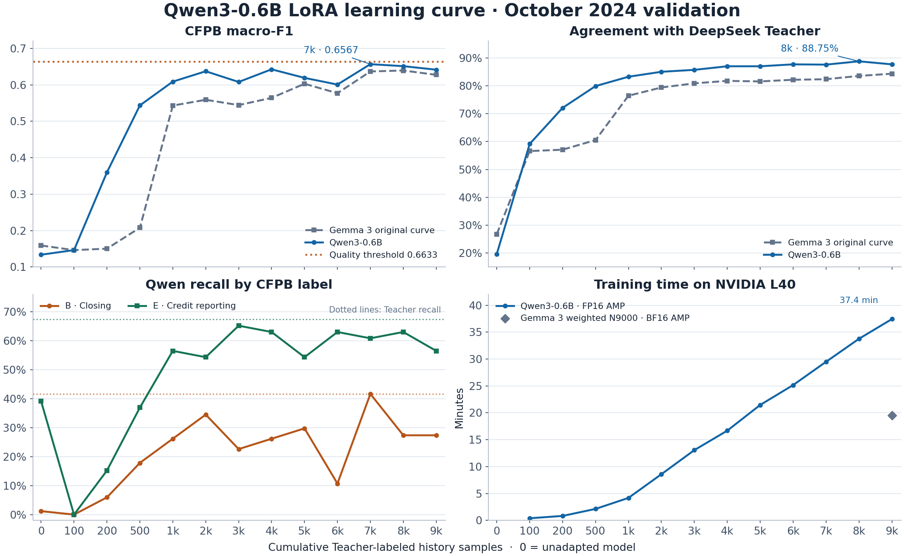

# Qwen3-0.6B LoRA 的 October validation 学习曲线

12 个 Qwen LoRA 节点都完成了同一批 **1,013 条**房贷投诉的验证。**7,000 条训练样本的 CFPB macro-F1 最高，为 0.6567**，距离沿用的质量门槛 **0.6633** 还有 0.0066。**8,000 条节点的 Teacher 一致率和准确率最高**，分别为 **88.75%（899/1,013）**和 **77.10%（781/1,013）**。全部节点的有效输出率为 100%。 [实验设计](../../../Experiment%20Design.md) · [DeepSeek 分区结果](../../teacher_deepseek-v4.1-flash-1017_all/note.md)

横轴按实际评估的训练规模等距排列。0 表示未微调的基座。前三幅图使用 October validation，训练用时图中的 Gemma 单点来自 L40 上另一次 N9000 加权实验。

## 实验设置与全部节点

各节点从相同修订的 Qwen3-0.6B 基座独立训练，使用 Gemma 学习曲线已有的 12 个按时间累积的 history 前缀。监督标签为冻结的 DeepSeek 输出，字母和 `<|im_end|>` 等权参与 loss。训练使用 NVIDIA L40、FP16 AMP、FP32 LoRA 参数与 AdamW 状态、rank 8、alpha 16、dropout 0.05、`q_proj` 和 `v_proj`、学习率 `2e-4`、3 个 epoch 和 seed 42。有效 batch 为 8，micro-batch 为 2，每次更新内按长度分批，gradient checkpointing 关闭。 [启动脚本](../../../student_qwen3_lora_fp16_mixed.sh) · [训练前缀清单](../../../data/lora/teacher_deepseek-v4.1-flash-1017_v3/manifest.json)

验证采用 v3、CUDA FP32 和贪心自由生成，Qwen 关闭 thinking。准确率和 macro-F1 以 CFPB 参考类别为准。Teacher 一致率衡量双方选中同一合法类别的比例，分母同为 1,013 条。固定预测 C 是按 history 多数类设定的基线。

| 训练条数 | 前缀截止日 UTC | CFPB 正确数 | 准确率 | Macro-F1 | Teacher 一致率 | 训练用时 |
| --- | --- | ---: | ---: | ---: | ---: | ---: |
| [未微调](../../../output/baseline_v3/student_qwen3-0.6b_validation_cuda/metrics.json) | — | 187 | 18.46% | 0.1337 | 19.64% | — |
| [100](../../../output/lora_eval/qwen3-0.6b_v3_n0100_fp16_mixed_mb2_validation/metrics.json) | 2024-01-04 | 563 | 55.58% | 0.1464 | 59.13% | 24 秒 |
| [200](../../../output/lora_eval/qwen3-0.6b_v3_n0200_fp16_mixed_mb2_validation/metrics.json) | 2024-01-08 | 645 | 63.67% | 0.3599 | 72.06% | 50 秒 |
| [500](../../../output/lora_eval/qwen3-0.6b_v3_n0500_fp16_mixed_mb2_validation/metrics.json) | 2024-01-18 | 713 | 70.38% | 0.5436 | 79.86% | 2 分 08 秒 |
| [1,000](../../../output/lora_eval/qwen3-0.6b_v3_n1000_fp16_mixed_mb2_validation/metrics.json) | 2024-02-01 | 734 | 72.46% | 0.6088 | 83.22% | 4 分 11 秒 |
| [2,000](../../../output/lora_eval/qwen3-0.6b_v3_n2000_fp16_mixed_mb2_validation/metrics.json) | 2024-02-28 | 758 | 74.83% | 0.6372 | 85.00% | 8 分 35 秒 |
| [3,000](../../../output/lora_eval/qwen3-0.6b_v3_n3000_fp16_mixed_mb2_validation/metrics.json) | 2024-03-27 | 746 | 73.64% | 0.6078 | 85.69% | 13 分 04 秒 |
| [4,000](../../../output/lora_eval/qwen3-0.6b_v3_n4000_fp16_mixed_mb2_validation/metrics.json) | 2024-04-24 | 776 | 76.60% | 0.6425 | 86.97% | 16 分 41 秒 |
| [5,000](../../../output/lora_eval/qwen3-0.6b_v3_n5000_fp16_mixed_mb2_validation/metrics.json) | 2024-05-28 | 759 | 74.93% | 0.6190 | 86.97% | 21 分 27 秒 |
| [6,000](../../../output/lora_eval/qwen3-0.6b_v3_n6000_fp16_mixed_mb2_validation/metrics.json) | 2024-06-30 | 763 | 75.32% | 0.6007 | 87.66% | 25 分 09 秒 |
| [7,000](../../../output/lora_eval/qwen3-0.6b_v3_n7000_fp16_mixed_mb2_validation/metrics.json) | 2024-07-31 | 777 | 76.70% | **0.6567** | 87.56% | 29 分 29 秒 |
| [8,000](../../../output/lora_eval/qwen3-0.6b_v3_n8000_fp16_mixed_mb2_validation/metrics.json) | 2024-08-28 | **781** | **77.10%** | 0.6512 | **88.75%** | 33 分 46 秒 |
| [9,000](../../../output/lora_eval/qwen3-0.6b_v3_n9000_fp16_mixed_mb2_validation/metrics.json) | 2024-09-25 | 774 | 76.41% | 0.6415 | 87.66% | 37 分 25 秒 |
| 固定预测 C | — | 562 | 55.48% | 0.1427 | 59.03% | — |
| DeepSeek Teacher | — | 796 | 78.58% | 0.6833 | — | — |

未微调 Qwen 和 12 个 LoRA 节点的全部输出都在第一次尝试时通过严格解析，逐条与首 token 五选一一致。未微调 Qwen 只将 4 条投诉预测为 CFPB 多数类 C。100 条节点在 1,013 条中预测 C 1,010 次，得分接近固定预测 C。 [验证复算与输出计数](analysis.json)

## 样本规模与类别表现

**200 至 2,000 条是主要改善阶段。** 200 条节点已经对五类各有至少一个 CFPB 真阳性，相比 100 条的 macro-F1 增加 0.2134。500 条达到 0.5436，1,000 条达到 0.6088。2,000 条节点与 Teacher 一致 861/1,013（约 85%），训练用时 8 分 35 秒。

**B 类波动解释了 6,000 至 8,000 条的分数变化。** CFPB 参考中有 84 条 B。Qwen 在 6,000 条节点只预测 12 条 B，答对 9 条。7,000 条节点预测 57 条 B，答对 35 条，B 召回升至 41.67%，与 DeepSeek 的 B 召回相同。到 8,000 条节点，B 预测回到 28 条，答对 23 条，精确率从 61.40% 升到 82.14%，召回降至 27.38%。因此 8,000 条比 7,000 条多答对 4 条、与 Teacher 多一致 12 条，macro-F1 则低 0.0055。 [Qwen 6,000 条指标](../../../output/lora_eval/qwen3-0.6b_v3_n6000_fp16_mixed_mb2_validation/metrics.json) · [Qwen 7,000 条指标](../../../output/lora_eval/qwen3-0.6b_v3_n7000_fp16_mixed_mb2_validation/metrics.json) · [Qwen 8,000 条指标](../../../output/lora_eval/qwen3-0.6b_v3_n8000_fp16_mixed_mb2_validation/metrics.json)

**C/D 是 8,000 条节点最大的 Teacher 分歧。** 在 Teacher 标签有效的 1,012 条投诉中，Qwen 有 113 条分歧，其中 26 条 Teacher C 被判成 D，27 条 Teacher D 被判成 C。Teacher 判为 B 的 43 条中，22 条一致，13 条被判成 C，8 条被判成 A。E 的 Teacher 一致率为 42/54（77.78%），CFPB 召回为 29/46（63.04%）。下面的分母按 Teacher 标签取值。 [8,000 条逐条预测](../../../output/lora_eval/qwen3-0.6b_v3_n8000_fp16_mixed_mb2_validation/predictions.csv)

| Teacher 类别 | 支持数 | Qwen 7,000 一致数 | Qwen 8,000 一致数 | Qwen 9,000 一致数 |
| --- | ---: | ---: | ---: | ---: |
| A 申请或再融资 | 85 | 54 | 69 | 71 |
| B 签约或交割 | 43 | 30 | 22 | 21 |
| C 管理现有贷款 | 598 | 563 | 561 | 556 |
| D 还款困难或救济 | 232 | 199 | 205 | 204 |
| E 征信及相关服务 | 54 | 41 | 42 | 36 |

## 与 Gemma 的配对比较

在相同 8,000 条训练前缀下，Qwen 比原 Gemma 多答对 **23 条**，Teacher 多匹配 **53 条**。Gemma 的 29 条空回复里，Qwen 有 23 条与 Teacher 一致。其余 984 条双方均输出合法类别的投诉中，Qwen 净多匹配 30 条。Qwen 2,000 条和原 Gemma 8,000 条都答对 758 条，macro-F1 相差 0.0021，说明更早的 Qwen 启动点值得纳入比较。原 Gemma 学习曲线使用 Quadro RTX 6000、FP32 和 micro-batch 1，这些差值描述两套实际训练方案。 [Gemma 原学习曲线](../gemma3-270m-it-v3-lora-curve/note.md) · [配对数据和输出分组](analysis.json)

下表对同一批投诉做 2,000 次配对 bootstrap，使用 seed 42 和 95% 百分位区间。区间描述这批固定模型的样本波动。训练只使用一个种子，7,000 和 8,000 条分别由这批验证集上的观察最高值选出。

| 比较 | CFPB macro-F1 差值与 95% 区间 | Teacher 一致率差值与 95% 区间（百分点） |
| --- | ---: | ---: |
| Qwen 7,000 − Qwen 6,000 | +0.0560 [+0.0179, +0.0938] | −0.10 [−2.07, +1.68] |
| Qwen 8,000 − Qwen 7,000 | −0.0055 [−0.0378, +0.0239] | +1.18 [−0.39, +2.76] |
| Qwen 8,000 − Qwen 9,000 | +0.0097 [−0.0181, +0.0373] | +1.09 [−0.39, +2.67] |
| Qwen 8,000 − 原 Gemma 8,000 | +0.0119 [−0.0173, +0.0421] | +5.23 [+3.06, +7.31] |
| Qwen 7,000 − Gemma 历史最高 macro-F1 | +0.0072 [−0.0290, +0.0466] | +3.46 [+1.09, +5.73] |
| Qwen 9,000 − L40 Gemma 加权 9,000 | +0.0036 [−0.0288, +0.0371] | +3.16 [+1.09, +5.23] |
| Qwen 7,000 − DeepSeek | −0.0266 [−0.0645, +0.0110] | — |

同训练规模下，8,000 和 9,000 条的两组 Qwen–Gemma 对比都有更高的 Teacher 一致率，配对区间均在零以上。Qwen 内部，8,000 条与 7,000 条、9,000 条的比较区间均跨零。Qwen 的最高 macro-F1 比 Gemma 历史最好值 0.6495 高 0.0072，区间也跨零。 [Gemma 超参实验](../gemma3-270m-it-v3-n9000-lora-sweep/note.md) · [配对区间完整数值](analysis.json)

## L40 训练时间与 JIT 冷启动

Qwen 的训练吞吐为 **11.48–12.65 条次/秒**，按 3 个 epoch 中实际重复读取的样本数计算。12 个节点累计训练 **3 小时 13 分 08 秒**，每组验证的累计推理尝试用时 **120.73–123.73 秒**。FP16 GradScaler 每组跳过 2–5 次非有限梯度更新，共 36 次。N9000 完成 3,372 次实际更新。 [训练用时与逐轮记录](analysis.json)

同为 L40 上的 N9000，Qwen 的 FP16、micro-batch 2 配置训练 **37 分 25 秒**，Gemma 的 BF16、micro-batch 4、B/E 加权配置训练 **19 分 30 秒**。两者的累计验证推理用时分别为 **122.90 秒**和 **65.04 秒**。Qwen 的 Teacher 一致率高 **3.16 个百分点**。这些数字比较的是两套实际运行配置。 [Qwen L40 训练记录](../../../output/lora/qwen3-0.6b_v3_n9000_fp16_mixed_mb2/training.json) · [Gemma L40 训练记录](../../../output/lora/gemma3-270m-it_v3_n9000_bf16_mixed_be1.5_torch28_mb4/training.json) · [Gemma L40 验证结果](../../../output/lora_eval/gemma3-270m-it_v3_n9000_bf16_mixed_be1.5_torch28_mb4_validation/metrics.json)

将原 Gemma 实验的 CFPB 门槛 **0.6633** 用作 Qwen 的对照，达标节点数为 **0/12**。如果后续比较以 Teacher 一致率为主，2,000 条节点对应较早的训练机会，截止于 2 月 28 日 UTC，8,000 条节点对应最高观察一致率，截止于 8 月 28 日 UTC。7,000 条节点则最接近现有 macro-F1 门槛。JIT 回放按一个预先选定的启动点计一次训练，并计入验证、加载及 Student 就绪前的 Teacher 服务。 [JIT 就绪与成本定义](../../../Experiment%20Design.md)

## 结果核验

13 个 Qwen 运行的 SQLite 最终输出与导出预测逐条相符。Qwen、Gemma 和 Teacher 的配对使用相同的 October 投诉 ID、输入哈希和 CFPB 参考标签。12 个 Qwen history 前缀与 Teacher 账本和前缀清单一致，训练 ID 与验证 ID 无交集。监督目标逐条核对为 Teacher 字母与 `<|im_end|>`。适配器配置文件通过哈希核验，训练和验证记录中的权重哈希相符，实际权重文件由 GPU 服务器保留。 [派生数据和源文件哈希](analysis.json)
